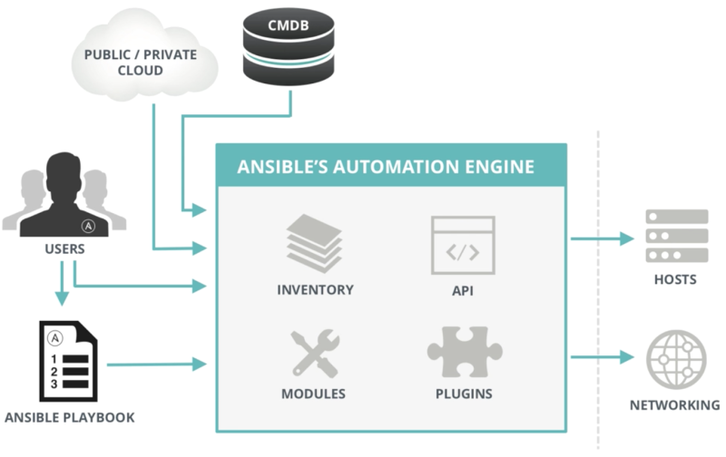

# 2.1 Ansible 이란?
- 애플리케이션 및 IT 인프라를 자동화할 수 있는 도구로, 호스트를 구성하고, 소프트웨어를 배포하고, 지속적인 배포 및 다운 타임 없는 롤링 업데이트 등의 고급 IT 작업 조율 가능
- 주요 목적은 간결성과 사용 용이성이며, 보안과 신뢰성을 바탕으로 OpenSSH를 기본 전송 방법으로 사용함. 또한 프로그래밍 언어에 익숙하지 않은 사람도 쉽게 사용 가능
- 모든 규모와 환경을 위해 설계됨
- 에이전트 없이 호스트를 관리하고, 관리 대상의 호스트에 데몬이 없기 때문에 데몬의 문제로 호스트를 관리할 수 없는 문제가 발생하지 않음

# 2.2 용어
## 2.2.1 제어 노드 (Control Node)
  - Ansible이 설치된 모든 호스트
## 2.2.2 관리 노드 (Managed Node)
  - Ansible로 관리하는 호스트 및 네트워크 장치
  - 관리 노드에 설치되지 않음
## 2.2.3 인벤토리 (Inventory)
  - 관리 노드 목록으로, 관리 노드에 대한 호스트 이름이나 IP 주소와 같은 정보를 지정함.
  - 여러 관리 노드를 그룹으로 조직화할 수 있고, 중첩 그룹을 사용할 수 있음
## 2.2.4 플러그인
  - 핵심 기능을 확장할 수 있도록 다양한 플러그인 제공
  - Action, Become, Cache, Callback, Cliconf, Connection, Httpapi, Inventory, NetConf, Lookup, Shell, Strategy, Vars
## 2.2.5 모듈 (Module)
  - Ansible을 실행하는 Python 코드 단위
  - 각 모듈은 호스트에 패키지를 설치 및 관리하고, 데이터베이스의 사용자를 관리하는 등 약 3,000개의 모듈이 있음
  - 한 모듈은 하나의 작업을 실행할 수 있고, 플레이북을 이용해 여러 모듈을 선언해 여러 작업을 수행할 수 있음
## 2.2.6 작업 (Task)
  - Ansible의 작업 실행 단위
  - 하나의 모듈이 하나의 작업이 되며, Ad-hoc 명령을 통해 단일 작업을 실행하거나, 플레이북을 작성해 여러 작업을 실행할 수 있음
## 2.2.7 Ad-hoc 명령
  - ansible 명령을 이용하여 단일 단업을 실행할 수 있음
## 2.2.8 플레이 (Play)
  - 특정 관리 노드를 대상으로 순서가 지정된 작업 목록
## 2.2.9 플레이북 (Playbook)
  - 하나 이상의 플레이를 가지고 있는 YAML 파일. ansible-playbook 명령을 이용해 플레이북을 실행할 수 있음
## 2.2.10 역할 (Role)
  - 알려진 파일 / 디렉토리 구조를 기반으로 관련 변수, 파일, 작업 등 아티팩트의 모음
## 2.2.11 컬렉션 (Collection)
  - 플레이북 및 역할, 모듈, 플러그인을 포함하는 Ansible 콘텐츠 배포 형식


# 2.3 아키텍처


# 2.4 Ansible 설치
```
[vagrant@ansible-controller ~]$ sudo dnf install -y ansible-core
[vagrant@ansible-controller ~]$ ansible --version
ansible [core 2.14.18]
  config file = /etc/ansible/ansible.cfg
  configured module search path = ['/home/vagrant/.ansible/plugins/modules', '/usr/share/ansible/plugins/modules']
  ansible python module location = /usr/lib/python3.9/site-packages/ansible
  ansible collection location = /home/vagrant/.ansible/collections:/usr/share/ansible/collections
  executable location = /usr/bin/ansible
  python version = 3.9.21 (main, Dec  5 2024, 00:00:00) [GCC 11.5.0 20240719 (Red Hat 11.5.0-2)] (/usr/bin/python3)
  jinja version = 3.1.2
  libyaml = True


```

