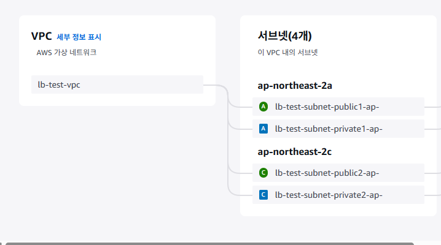

- 모든 작업은 서울 리전으로

### 사용자 보안 자격 증명
- MFA 할당

## EC2
- 인스턴스 시작


# 2.1
## 2.1.1 컴퓨팅 정의
- 어떤 것에 대해 계산하여 답을 구하고 추정하는 행위

## 2.1.2 AWS 컴퓨팅 서비스
- 


```shell
PS C:\Users\Admin\Downloads> ssh -i "mykey-mjkim.pem" ec2-user@ec2-54-180-147-213.ap-northeast-2.compute.amazonaws.com
   ,     #_
   ~\_  ####_        Amazon Linux 2023
  ~~  \_#####\
  ~~     \###|
  ~~       \#/ ___   https://aws.amazon.com/linux/amazon-linux-2023
   ~~       V~' '->
    ~~~         /
      ~~._.   _/
         _/ _/
       _/m/'
Last login: Mon Dec  1 04:40:51 2025 from 13.209.1.60

[ec2-user@ip-172-31-40-90 ~]$ touch mykey.pem
[ec2-user@ip-172-31-40-90 ~]$ ls -l mykey.pem
-rw-r--r--. 1 ec2-user ec2-user 0 Dec  1 04:47 mykey.pem
[ec2-user@ip-172-31-40-90 ~]$ chmod 400 mykey.pem
[ec2-user@ip-172-31-40-90 ~]$ ls -l mykey.pem
-r--------. 1 ec2-user ec2-user 0 Dec  1 04:47 mykey.pem
[ec2-user@ip-172-31-40-90 ~]$ exit
logout
Connection to ec2-54-180-147-213.ap-northeast-2.compute.amazonaws.com closed.
```

- 재접속
```shell
PS C:\Users\Admin\Downloads> ssh -i "mykey-mjkim.pem" ec2-user@ec2-54-180-147-213.ap-northeast-2.compute.amazonaws.com
   ,     #_
   ~\_  ####_        Amazon Linux 2023
  ~~  \_#####\
  ~~     \###|
  ~~       \#/ ___   https://aws.amazon.com/linux/amazon-linux-2023
   ~~       V~' '->
    ~~~         /
      ~~._.   _/
         _/ _/
       _/m/'
Last login: Mon Dec  1 04:44:22 2025 from 60.196.24.130

[ec2-user@ip-172-31-40-90 ~]$ lsblk
NAME      MAJ:MIN RM SIZE RO TYPE MOUNTPOINTS
xvda      202:0    0   8G  0 disk
├─xvda1   202:1    0   8G  0 part /
├─xvda127 259:0    0   1M  0 part
└─xvda128 259:1    0  10M  0 part /boot/efi

[ec2-user@ip-172-31-40-90 ~]$ free -h
               total        used        free      shared  buff/cache   available
Mem:           949Mi       119Mi       609Mi       0.0Ki       220Mi       692Mi
Swap:             0B          0B          0B

[ec2-user@ip-172-31-40-90 ~]$ ls ~/.ssh/authorized_keys 
/home/ec2-user/.ssh/authorized_keys

[ec2-user@ip-172-31-40-90 ~]$ cat ~/.ssh/authorized_keys
ssh-rsa AAAAB3NzaC1yc2EAAAADAQABAAABAQCr4bWg06rgAWj6XT+T9vhHp4VoAU085TmzIePau0+3xsAyYUjil70g2luBbxqVhtiHBTN3vBJ48YUdIDgXrbA4a6NDODIh46JBvckmvvcvb4iBHKGNxM55Yj/cM4m77VPCGmOKb9A5iw2a5pD2trmKrRaaTwJGhTUbpyEg5Gzrs4w0w2DxS/sTaCvD4S7PNGdWgCSv0FwDlFRJWQtQcCV3snYYZ1AbLbLGBIFryvkwp9S8MR/oFmevbxLVENQOh7hNNO54qnLoQl/93s3dMRhX9Iw7w0lxdP9Nlx5JV43Z4DAZWTbcudXohST1QelznzFDaJ7er0WwzmGilz+D8GRn mykey-mjkim

[ec2-user@ip-172-31-40-90 ~]$ lscpu
Architecture:                x86_64
  CPU op-mode(s):            32-bit, 64-bit
  Address sizes:             46 bits physical, 48 bits virtual
  Byte Order:                Little Endian
  ...

[ec2-user@ip-172-31-40-90 ~]$ ip addr show
...
2: enX0: <BROADCAST,MULTICAST,UP,LOWER_UP> mtu 9001 qdisc fq_codel state UP group default qlen 1000
    link/ether 0a:61:86:73:f1:81 brd ff:ff:ff:ff:ff:ff
    altname eni-07548fa1cf36cae7b
    altname device-number-0.0
    inet 172.31.40.90/20 metric 512 brd 172.31.47.255 scope global dynamic enX0
       valid_lft 2128sec preferred_lft 2128sec
    inet6 fe80::861:86ff:fe73:f181/64 scope link proto kernel_ll
       valid_lft forever preferred_lft forever
```

- 웹서버 세팅
```shell
[ec2-user@ip-172-31-40-90 ~]$ sudo yum install -y httpd

[ec2-user@ip-172-31-40-90 ~]$ sudo systemctl enable --now httpd
Created symlink /etc/systemd/system/multi-user.target.wants/httpd.service → /usr/lib/systemd/system/httpd.service.

[ec2-user@ip-172-31-40-90 ~]$ echo "test my webserver" | sudo tee /var/www/html/index.html
test my webserver

[ec2-user@ip-172-31-40-90 ~]$ curl localhost
test my webserver

[ec2-user@ip-172-31-40-90 ~]$ curl 172.31.40.90
test my webserver
```

```shell
[ec2-user@ip-172-31-36-185 ~]$ ping 3.39.190.141
PING 3.39.190.141 (3.39.190.141) 56(84) bytes of data.
^C
--- 3.39.190.141 ping statistics ---
2 packets transmitted, 0 received, 100% packet loss, time 1043ms

[ec2-user@ip-172-31-36-185 ~]$ ssh ec2-user@3.39.190.141
The authenticity of host '3.39.190.141 (3.39.190.141)' can't be established.
ED25519 key fingerprint is SHA256:GSRDIflglb/+vcVaTPvAuvnc8E+ISdk4BTG+O/7kQos.
This key is not known by any other names
Are you sure you want to continue connecting (yes/no/[fingerprint])? yes
Warning: Permanently added '3.39.190.141' (ED25519) to the list of known hosts.
ec2-user@3.39.190.141: Permission denied (publickey,gssapi-keyex,gssapi-with-mic).
[ec2-user@ip-172-31-36-185 ~]$ vi mykey.pem

***REMOVED_PRIVATE_KEY***

[ec2-user@ip-172-31-36-185 ~]$ chmod 400 mykey.pem
[ec2-user@ip-172-31-36-185 ~]$ ssh -i mykey.pem ec2-user@3.39.190.141
   ,     #_
   ~\_  ####_        Amazon Linux 2023
  ~~  \_#####\
  ~~     \###|
  ~~       \#/ ___   https://aws.amazon.com/linux/amazon-linux-2023
   ~~       V~' '->
    ~~~         /
      ~~._.   _/
         _/ _/
       _/m/'
Last login: Mon Dec  1 06:00:58 2025 from 60.196.24.130
```


### AWS 인스턴스 실습
1. webserver라는 이름의 인스턴스를 하나 만드세요. 생성 시 키페어는 기존에 만들어둔 mykey를 지정하고 나머지 항목들은 기본 값을 사용합니다. (기본값 사용 시 보안 그룹은 ssh만 허용)

2. 내 컴퓨터에서 터미널을 열어서 ssh로 인스턴스에 접속을 해보세요. (접속됨)
```sh
ssh -i "mykey-mjkim.pem" ec2-user@ec2-15-164-229-142.ap-northeast-2.compute.amazonaws.com
yes
```

3. 인스턴스에서 8.8.8.8로 ping을 보내보세요. (됨)
```sh
[ec2-user@ip-172-31-32-102 ~]$ ping 8.8.8.8
PING 8.8.8.8 (8.8.8.8) 56(84) bytes of data.
64 bytes from 8.8.8.8: icmp_seq=1 ttl=107 time=30.8 ms
64 bytes from 8.8.8.8: icmp_seq=2 ttl=107 time=30.9 ms
...
```

4. 인스턴스에 웹서버를 구성하세요.
```sh
[ec2-user@ip-172-31-32-102 ~]$ sudo yum install -y httpd
[ec2-user@ip-172-31-32-102 ~]$ sudo systemctl enable --now httpd
[ec2-user@ip-172-31-32-102 ~]$ echo "webserver practice" | sudo tee /var/www/html/index.html
```

5. 인스턴스에서 curl 명령어로 접속해보세요. (됨)
```sh
[ec2-user@ip-172-31-32-102 ~]$ echo "webserver practice" | sudo tee /var/www/html/index.html
```

6. 내 컴퓨터에서 브라우저에 인스턴스의 프라이빗 IP를 입력해 접속해보세요. (안 됨)
-> 172.31.32.102

7. 내 컴퓨터에서 브라우저에 인스턴스의 퍼블릭 IP를 입력해 접속해보세요. (안 됨)
-> 15.164.229.142

8. 내 컴퓨터에서 터미널을 열고 인스턴스의 퍼블릭 / 프라이빗 IP로 ping 테스트 (안 됨)
```sh
[ec2-user@ip-172-31-32-102 ~]$ ping 172.31.32.102
PING 172.31.32.102 (172.31.32.102) 56(84) bytes of data.
64 bytes from 172.31.32.102: icmp_seq=1 ttl=127 time=0.020 ms
64 bytes from 172.31.32.102: icmp_seq=2 ttl=127 time=0.027 ms
^C
--- 172.31.32.102 ping statistics ---
2 packets transmitted, 2 received, 0% packet loss, time 1038ms
rtt min/avg/max/mdev = 0.020/0.023/0.027/0.003 ms

[ec2-user@ip-172-31-32-102 ~]$ ping 15.164.229.142
PING 15.164.229.142 (15.164.229.142) 56(84) bytes of data.
^C
--- 15.164.229.142 ping statistics ---
14 packets transmitted, 0 received, 100% packet loss, time 13495ms
```

9. 기존의 보안 그룹에 모든 ICMP를 허용 규칙을 추가하고 ping 테스트를 해보세요 (됨)
-> 인바운드 규칙 편집 - 규칙 추가 - 모든 ICMP-IPv4 - Anywhere IPv4 -> 규칙 저장
```sh
[ec2-user@ip-172-31-32-102 ~]$ ping 15.164.229.142
PING 15.164.229.142 (15.164.229.142) 56(84) bytes of data.
64 bytes from 15.164.229.142: icmp_seq=1 ttl=126 time=0.353 ms
64 bytes from 15.164.229.142: icmp_seq=2 ttl=126 time=0.345 ms
^C
--- 15.164.229.142 ping statistics ---

[ec2-user@ip-172-31-32-102 ~]$ ping 172.31.32.102
PING 172.31.32.102 (172.31.32.102) 56(84) bytes of data.
64 bytes from 172.31.32.102: icmp_seq=1 ttl=127 time=0.023 ms
64 bytes from 172.31.32.102: icmp_seq=2 ttl=127 time=0.040 ms
^C
--- 172.31.32.102 ping statistics ---
2 packets transmitted, 2 received, 0% packet loss, time 1057ms
```

10. 새로운 보안 그룹을 만들고 내 IP에서만 http 접속이 가능하도록 규칙을 추가하세요.
-> 보안 그룹 생성 - 인바운드 규칙 - 규칙 추가 - HTTP - 내 IP - 보안 그룹 생성

11. 내 컴퓨터에서 브라우저로 접속해보세요. (퍼블릭 IP만 됨)
-> 퍼블릭/15.164.229.142 (O)
-> 프라이빗/172.31.32.102 (X)

12. 새로운 인스턴스를 client라는 이름으로 만드세요. (조건은 1번처럼)
13. 내 컴퓨터에서 client 인스턴스로 원격 접속하세요.
```sh
PS C:\Users\Admin\AWS Korea_sesac> cd..
PS C:\Users\Admin> cd .\Downloads\
PS C:\Users\Admin\Downloads> ssh -i "mykey-mjkim.pem" ec2-user@ec2-13-209-43-103.ap-northeast-2.compute.amazonaws.com
```

14. client 인스턴스에서 webserver 인스턴스로 ping / curl / ssh로 접속 확인해보세요.
  (ping은 모두 가능, curl은 불가능, ssh는 키가 없어서 불가능)
->
```sh
[ec2-user@ip-172-31-37-113 ~]$ ping 172.31.32.102
PING 172.31.32.102 (172.31.32.102) 56(84) bytes of data.
64 bytes from 172.31.32.102: icmp_seq=1 ttl=127 time=0.945 ms
64 bytes from 172.31.32.102: icmp_seq=2 ttl=127 time=0.430 ms
^C
--- 172.31.32.102 ping statistics ---
2 packets transmitted, 2 received, 0% packet loss, time 1001ms
rtt min/avg/max/mdev = 0.430/0.687/0.945/0.257 ms

[ec2-user@ip-172-31-37-113 ~]$ ping 15.164.229.142
PING 15.164.229.142 (15.164.229.142) 56(84) bytes of data.
64 bytes from 15.164.229.142: icmp_seq=1 ttl=126 time=0.564 ms
64 bytes from 15.164.229.142: icmp_seq=2 ttl=126 time=1.16 ms
^C
--- 15.164.229.142 ping statistics ---
2 packets transmitted, 2 received, 0% packet loss, time 1074ms
rtt min/avg/max/mdev = 0.564/0.861/1.159/0.297 ms

[ec2-user@ip-172-31-37-113 ~]$ curl 172.31.32.102
^C

[ec2-user@ip-172-31-37-113 ~]$ curl 15.164.229.142
^C

[ec2-user@ip-172-31-37-113 ~]$ ssh 172.31.32.102
The authenticity of host '172.31.32.102 (172.31.32.102)' can't be established.
ED25519 key fingerprint is SHA256:h527WlRa1dEIgpKkYWfBiHzd53MN05kKYdXNyrldUTk.
This key is not known by any other names
Are you sure you want to continue connecting (yes/no/[fingerprint])? yes
Warning: Permanently added '172.31.32.102' (ED25519) to the list of known hosts.
ec2-user@172.31.32.102: Permission denied (publickey,gssapi-keyex,gssapi-with-mic).

[ec2-user@ip-172-31-37-113 ~]$ ssh 15.164.229.142
The authenticity of host '15.164.229.142 (15.164.229.142)' can't be established.
ED25519 key fingerprint is SHA256:h527WlRa1dEIgpKkYWfBiHzd53MN05kKYdXNyrldUTk.
This host key is known by the following other names/addresses:
    ~/.ssh/known_hosts:1: 172.31.32.102
Are you sure you want to continue connecting (yes/no/[fingerprint])? yes
Warning: Permanently added '15.164.229.142' (ED25519) to the list of known hosts.
ec2-user@15.164.229.142: Permission denied (publickey,gssapi-keyex,gssapi-with-mic).
```

15. 내 컴퓨터에 있는 개인 키파일을 복사해서 인스턴스 안에 생성하세요. 이후 다시 client에서 webserver 인스턴스로 ssh 접속해보세요. (퍼블릭 / 프라이빗 다 가능)
```sh
[ec2-user@ip-172-31-37-113 ~]$ vi mykey.pem

[ec2-user@ip-172-31-37-113 ~]$ chmod 400 mykey.pem
[ec2-user@ip-172-31-37-113 ~]$ ssh -i mykey.pem ec2-user@15.164.229.142
   ,     #_
   ~\_  ####_        Amazon Linux 2023
  ~~  \_#####\
  ~~     \###|
  ~~       \#/ ___   https://aws.amazon.com/linux/amazon-linux-2023
   ~~       V~' '->
    ~~~         /
      ~~._.   _/
         _/ _/
       _/m/'
Last login: Mon Dec  1 07:01:57 2025 from 60.196.24.130
[ec2-user@ip-172-31-32-102 ~]$ exit
logout
Connection to 15.164.229.142 closed.

[ec2-user@ip-172-31-37-113 ~]$ ssh -i mykey.pem ec2-user@172.31.32.102
   ,     #_
   ~\_  ####_        Amazon Linux 2023
  ~~  \_#####\
  ~~     \###|
  ~~       \#/ ___   https://aws.amazon.com/linux/amazon-linux-2023
   ~~       V~' '->
    ~~~         /
      ~~._.   _/
         _/ _/
       _/m/'
Last login: Mon Dec  1 07:32:39 2025 from 13.209.43.103
[ec2-user@ip-172-31-32-102 ~]$ exit
logout
Connection to 172.31.32.102 closed.
```

16. webserver 인스턴스에 있는 모든 보안 그룹을 제거하고 내 컴퓨터와 client 인스턴스에서 각각 접속 시도해보세요. (양쪽에서 ssh, ping, curl 모두 안 됨)
-> 보안 그룹 변경 - 보안 그룹 제거

17. 두 인스턴스 모두 default 보안 그룹을 추가하고 위 테스트를 다시 해보세요. (인스턴스에서만 모두 가능)
18. 두 인스턴스 및 보안 그룹을 모두 삭제합니다. (default 보안 그룹은 지우지 마세요.)


```sh
PS C:\Users\Admin\Downloads> ssh -i .\mykey-mjkim.pem ec2-user@3.36.66.9 
yes

[ec2-user@ip-172-31-32-223 ~]$ sudo vi /var/log/cloud-init-output.log

[ec2-user@ip-172-31-32-223 ~]$ sudo systemctl start httpd
[ec2-user@ip-172-31-32-223 ~]$ sudo systemctl enable httpd
Created symlink /etc/systemd/system/multi-user.target.wants/httpd.service → /usr/lib/systemd/system/httpd.service.
```

### VPC 실습
1. 다음 조건에 맞는 VPC 및 구성 요소들을 한 번에 만드세요.
- VPC 이름: test-vpc
- VPC 대역: 172.17.0.0/16
- 가용 영역: a, b 사용
- 퍼블릭 서브넷: 2개
- 프라이빗 서브넷: 4개
-> 8개의 서브넷을 만들 수 있도록 IP 대역을 딱 맞춰보세요.

2. 새로운 서브넷을 2개 생성하고 위 VPC에 연결해보세요.
하나는 a 가용 영역, 하나는 b 가용 영역을 사용합니다.
IP 대역은 남은 범위를 사용하세요.

### 실습
test-vpc에 생성한 인스턴스에는 ssh만 허용
default-vpc에 생성한 인스턴스에는 ssh+icmp 허용

test-vpc에 있는 인스턴스에 원격접속해서
default-vpc에 있는 인스턴스로 ping 테스트

현재는 서로 다른 vpc이기 때문에 public IP로는 가능 / private IP로는 안 됨
  -> vpc 피어링 설정 후에는 연결이 됨

### 피어링 설정 순서
1. VPC 서비스에서 피어링 연결 탭으로 이동 후 생성 버튼 클릭
2. 연결하려는 다른 VPC 서비스에서 피어링 연결 탭 연결 버튼으로 연결
3. 각 VPC에서 라우팅 테이블 규칙에 상대방 주소 대역에 대한 경로를 추가

### 로드밸런서 서비스 실습
1. lb-test라는 이름의 VPC를 생성하세요. (IP 대역은 192.168.0.0/16)
  가용 영역은 a와 c를 사용하고 서브넷은 각각 퍼블릭1, 프라이빗1 생성하세요.
  

2. 각 가용 영역의 프라이빗 서브넷에 웹서버를 구성한 인스턴스를 하나씩 생성하세요.
  보안 그룹은 default 그룹만 설정합니다.

```sh
#!/bin/bash

yum install -y httpd
systemctl enable —now httpd
echo "Test Webserver 01" > /var/www/html/index.html
```

3. a 가용 영역의 퍼블릭 서브넷에 public-vm 이라는 이름의 인스턴스를 생성하세요.
  보안 그룹은 default 그룹, ssh 그룹 두 개 추가합니다.
  ssh 그룹은 내 pc에서만 ssh 접속이 가능한 규칙입니다.
  
4. public-vm 인스턴스에 원격 접속해서 각 웹서버 인스턴스에 curl 명령어로 접속해보세요.
5. 웹서버 인스턴스 2개를 대상 그룹으로 설정해주세요.
6. NLB를 내부용으로 생성해서 위 대상 그룹을 연결하고 NLB를 통해서 웹서버를 접속해보세요.
7. 웹서버 인스턴스를 모두 삭제하고 시작 템플릿을 설정하세요.
  시작 템플릿에는 이미지는 amazon linux, 키페어 지정, 보안 그룹 default, 스크립트 작성 (웹서버 구성) 이외의 설정은 모두 포함하지 않음으로 설정
8. 위 시작 템플릿을 이용해 오토 스케일링 그룹을 지정하고 해당 그룹을 위 로드밸런서에 대상 그룹으로 설정해보세요. (개수는 1~4로 설정)


### 정리
- VPC: AWS에서 사용자들이 사용할 격리된 네트워크 공간
- 서브넷: VPC 영역 안에 각 가용영역별로 서브넷 생성 가능
  -> 라우팅 테이블의 규칙에 따라 IGW로 연결하면 퍼블릭 서브넷
  퍼블릭 서브넷만 인터넷이 가능
  프라이빗 서브넷은 인터넷이 안 됨 -> 일반적으로 패키지 설치 등도 안 됨
  (Amazon Linux는 자체적으로 S3 패키지 저장소 구성 중)
- 네트워크 통신
  1. 동일한 VPC 영역 안에서는 서브넷 구분 없이 모두 통신 가능 (Private IP)
  2. 퍼블릭 서브넷은 IGW를 통해서 외부와도 통신 가능 (Public IP)
  3. 서로 다른 VPC의 인스턴스들은 서로 통신이 안 됨 (Private IP)
  4. VPC Peering + 라우팅 테이블 설정 시 서로 다른 VPC도 통신 가능 (Private IP)
  5. 네트워크 ACL의 규칙에 따라서 서브넷 전체 범위에 대한 접근 제어 (1차)
  6. 보안 그룹의 규칙에 따라서 개별 인스턴스에 대한 접근 제어 (2차)
  7. Public IP는 인스턴스 재부팅 시 변경될 수 있음 (고정 IP 필요 시에는 Elastic IP)
- 로드 밸런서: 부하 분산 + 가용성 확보 + 장애 조치 등을 위해 사용
  AWS에서는 ALB, NLB, GWLB 제공
  - ALB: L7 로드밸런서 (HTTP 헤더 확인 가능)
    -> 경로 등의 확인도 가능
  - NLB: L4 로드밸런서 (TCP/UDP 헤더 확인)
    -> 포트 번호에 따라서 포워딩
- 대상 그룹: 로드밸런서를 통해 연결할 대상 
  - ALB: 인스턴스, 람다 등을 지정 (실제 서버)
  - NLB: ALB까지 지정 가능
- 오토 스케일링: 대상 그룹을 동적을 관리
  - scale up: 시스템의 스펙을 업그레이드
  - scale down: 시스템의 스펙을 다운그레이드
  - scale out: 시스템의 개수를 증가
  - scale in: 시스템의 개수를 감소
- 시작 템플릿: 인스턴스 생성 방식 (이미지 등을 지정)
  -> 사전에 이미지를 완성본으로 생성해두면 생성 속도가 빠름
  + 구성 시 인터넷이 필요한 작업이 완성되어 있어서 유리


```sh
PS C:\Users\Admin\Downloads> ssh -i "mykey-mjkim.pem" ec2-user@ec2-54-180-123-131.ap-northeast-2.compute.amazonaws.com

[ec2-user@ip-172-31-39-72 ~]$ lsblk
NAME      MAJ:MIN RM SIZE RO TYPE MOUNTPOINTS
xvda      202:0    0   8G  0 disk
├─xvda1   202:1    0   8G  0 part /
├─xvda127 259:0    0   1M  0 part
└─xvda128 259:1    0  10M  0 part /boot/efi

# EBS 볼륨 추가 후
[ec2-user@ip-172-31-39-72 ~]$ lsblk
NAME      MAJ:MIN RM SIZE RO TYPE MOUNTPOINTS
xvda      202:0    0   8G  0 disk
├─xvda1   202:1    0   8G  0 part /
├─xvda127 259:0    0   1M  0 part
└─xvda128 259:1    0  10M  0 part /boot/efi
xvdb      202:16   0   1G  0 disk

[ec2-user@ip-172-31-39-72 ~]$ sudo blkid
/dev/xvda128: SEC_TYPE="msdos" UUID="9682-52BE" BLOCK_SIZE="512" TYPE="vfat" PARTLABEL="EFI System Partition" PARTUUID="60cefbf9-6c4e-415b-ad90-2f22c31cc560"
/dev/xvda127: PARTLABEL="BIOS Boot Partition" PARTUUID="2fd75656-066f-4219-9e47-c479b13361d2"
/dev/xvda1: LABEL="/" UUID="9a57ac2f-bfe7-4e29-bf89-56caddc22c97" BLOCK_SIZE="4096" TYPE="xfs" PARTLABEL="Linux" PARTUUID="a5eb1a81-0114-4105-9651-d58c43f2a722"

[ec2-user@ip-172-31-39-72 ~]$ sudo fdisk /dev/xvdb


[ec2-user@ip-172-31-39-72 ~]$ lsblk
NAME      MAJ:MIN RM  SIZE RO TYPE MOUNTPOINTS
xvda      202:0    0    8G  0 disk
├─xvda1   202:1    0    8G  0 part /
├─xvda127 259:0    0    1M  0 part
└─xvda128 259:1    0   10M  0 part /boot/efi
xvdb      202:16   0    1G  0 disk
└─xvdb1   202:17   0 1023M  0 part

[ec2-user@ip-172-31-39-72 ~]$ sudo mkfs -t xfs /dev/xvdb1

[ec2-user@ip-172-31-39-72 ~]$ sudo blkid /dev/xvdb1
/dev/xvdb1: UUID="40029841-4efa-4d0f-8b27-ab12c7d0c445" BLOCK_SIZE="512" TYPE="xfs" PARTUUID="288dc05a-01"
[ec2-user@ip-172-31-39-72 ~]$ sudo mount /dev/xvdb1 /mnt

[ec2-user@ip-172-31-39-72 ~]$ sudo mount | grep mnt
/dev/xvdb1 on /mnt type xfs (rw,relatime,seclabel,attr2,inode64,logbufs=8,logbsize=32k,noquota)

[ec2-user@ip-172-31-39-72 ~]$ echo "test volume" | sudo tee /mnt/first.txt
```

```sh
# 인스턴스 생성 시 부터 볼륨 추가했을 경우
PS C:\Users\Admin\Downloads> ssh -i "mykey-mjkim.pem" ec2-user@ec2-54-180-32-197.ap-northeast-2.compute.amazonaws.com

[ec2-user@ip-172-31-34-198 ~]$ lsblk
NAME      MAJ:MIN RM SIZE RO TYPE MOUNTPOINTS
xvda      202:0    0   8G  0 disk
├─xvda1   202:1    0   8G  0 part /
├─xvda127 259:0    0   1M  0 part
└─xvda128 259:1    0  10M  0 part /boot/efi
xvdb      202:16   0   2G  0 disk

[ec2-user@ip-172-31-34-198 ~]$ sudo blkid
/dev/xvda128: SEC_TYPE="msdos" UUID="9682-52BE" BLOCK_SIZE="512" TYPE="vfat" PARTLABEL="EFI System Partition" PARTUUID="60cefbf9-6c4e-415b-ad90-2f22c31cc560"
/dev/xvda127: PARTLABEL="BIOS Boot Partition" PARTUUID="2fd75656-066f-4219-9e47-c479b13361d2"
/dev/xvda1: LABEL="/" UUID="9a57ac2f-bfe7-4e29-bf89-56caddc22c97" BLOCK_SIZE="4096" TYPE="xfs" PARTLABEL="Linux" PARTUUID="a5eb1a81-0114-4105-9651-d58c43f2a722"

# 1G 볼륨 연결 후
[ec2-user@ip-172-31-34-198 ~]$ lsblk
NAME      MAJ:MIN RM  SIZE RO TYPE MOUNTPOINTS
xvda      202:0    0    8G  0 disk
├─xvda1   202:1    0    8G  0 part /
├─xvda127 259:0    0    1M  0 part
└─xvda128 259:1    0   10M  0 part /boot/efi
xvdb      202:16   0    2G  0 disk
xvdc      202:32   0    1G  0 disk
└─xvdc1   202:33   0 1023M  0 part

[ec2-user@ip-172-31-34-198 ~]$ sudo blkid /dev/xvdc1
/dev/xvdc1: UUID="40029841-4efa-4d0f-8b27-ab12c7d0c445" BLOCK_SIZE="512" TYPE="xfs" PARTUUID="288dc05a-01"

[ec2-user@ip-172-31-34-198 ~]$ sudo mount /dev/xvdc1 /mnt
[ec2-user@ip-172-31-34-198 ~]$ ls /mnt
first.txt
[ec2-user@ip-172-31-34-198 ~]$ cat /mnt/first.txt
test volume
```

### EFS
```sh
PS C:\Users\Admin\Downloads> ssh -i "mykey-mjkim.pem" ec2-user@ec2-3-39-195-141.ap-northeast-2.compute.amazonaws.com

[ec2-user@ip-172-31-35-107 ~]$ mkdir efs
[ec2-user@ip-172-31-35-107 ~]$ sudo mount -t nfs4 -o nfsvers=4.1,rsize=1048576,wsize=1048576,hard,timeo=600,retrans=2,noresvport fs-0cfd07065bf55df81.efs.ap-northeast-2.amazonaws.com:/ efs

[ec2-user@ip-172-31-35-107 ~]$ echo "test efs" | sudo tee efs/first.txt
test efs

# 새 인스턴스 연결 후 /mnt 접속
[ec2-user@ip-172-31-34-85 ~]$ sudo mount -t nfs4 -o nfsvers=4.1,rsize=1048576,wsize=1048576,hard,timeo=600,retrans=2,noresvport fs-0cfd07065bf55df81.efs.ap-northeast-2.amazonaws.com:/ /mn
t

[ec2-user@ip-172-31-35-107 ~]$ sudo yum install -y amazon-efs-utils
[ec2-user@ip-172-31-35-107 ~]$ sudo mount -t efs -o tls fs-0cfd07065bf55df81:/ efs

[ec2-user@ip-172-31-35-107 ~]$ sudo umount efs
[ec2-user@ip-172-31-35-107 ~]$ sudo mount -t efs -o tls fs-0cfd07065bf55df81:/ efs
```

### S3 권한 정리
  1. 버킷 단위로 퍼블릭 여부를 설정 가능
  비활성화 시에는 해당 계정에서만 버킷 및 객채에 접근 가능
  활성화 시에는 계정 상관 없이 버킷 및 개체에 접근 허용
  2. 객체 단위로 접근 권한 설정 가능
  버킷도 퍼블릭 + 객체도 퍼블릭 설정 시에는 객체 접근 가능
  둘 중에 하나라도 비활성화하면 접근 안 됨
  3. 버킷 단위로 객체 목록 및 확인 권한을 설정 가능
  해당 버킷에 있는 객체 및 폴더의 목록만 학인 가능

### DB
```sh
PS C:\Users\Admin\Downloads> ssh -i "mykey-mjkim.pem" ec2-user@ec2-13-209-73-14.ap-northeast-2.compute.amazonaws.com

[ec2-user@ip-172-31-42-32 ~]$ sudo yum install -y mariadb1011
[ec2-user@ip-172-31-42-32 ~]$ mysql -u admin -h database-1.cjq46m4iyk30.ap-northeast-2.rds.amazonaws.com -p

MySQL [(none)]> show databases;
+--------------------+
| Database           |
+--------------------+
| information_schema |
| mysql              |
| performance_schema |
| sys                |
+--------------------+
4 rows in set (0.001 sec)

MySQL [(none)]> exit
Bye
```

### AWS 스토리지 실습 가이드
1. EBS 실습
    1) 인스턴스 생성(키페어빼고 기본값) 후 접속해서 스토리지 연결 정보를 확인해보세요.
    ```sh
    PS C:\Users\Admin\Downloads> ssh -i "mykey-mjkim.pem" ec2-user@ec2-13-209-97-246.ap-northeast-2.compute.amazonaws.com
    [ec2-user@ip-172-31-45-224 ~]$ lsblk
    ```

    2) EBS 탭에서 새로운 볼륨을 생성하고 인스턴스에 연결 후 확인해보세요.
    ```sh
    [ec2-user@ip-172-31-45-224 ~]$ lsblk
    NAME      MAJ:MIN RM SIZE RO TYPE MOUNTPOINTS
    xvda      202:0    0   8G  0 disk
    ├─xvda1   202:1    0   8G  0 part /
    ├─xvda127 259:0    0   1M  0 part
    └─xvda128 259:1    0  10M  0 part /boot/efi
    xvdb      202:16   0   1G  0 disk
    ```

    3) 포멧 및 마운트 후에 해당 볼륨에 파일을 저장하세요.
    ```sh
    [ec2-user@ip-172-31-45-224 ~]$ sudo fdisk /dev/xvdb
    [ec2-user@ip-172-31-45-224 ~]$ sudo mkfs -t xfs /dev/xvdb1
    [ec2-user@ip-172-31-45-224 ~]$ sudo mount /dev/xvdb1 /mnt
    [ec2-user@ip-172-31-45-224 ~]$ echo "prac" | sudo tee /mnt/prac.txt
    [ec2-user@ip-172-31-45-224 ~]$ cat /mnt/prac.txt
    prac
    ```

    4) 마운트 해제 후 인스턴스와의 연결을 해제하세요.

    ```sh
    [ec2-user@ip-172-31-45-224 ~]$ sudo umount /mnt
    ```

    5) 새로운 인스턴스를 생성하고 새로운 인스턴스에 기존의 볼륨을 연결해서 확인해보세요.
    ```sh
    PS C:\Users\Admin\Downloads> ssh -i "mykey-mjkim.pem" ec2-user@ec2-52-79-222-24.ap-northeast-2.compute.amazonaws.com
    
    [ec2-user@ip-172-31-42-64 ~]$ lsblk
    NAME      MAJ:MIN RM  SIZE RO TYPE MOUNTPOINTS
    xvda      202:0    0    8G  0 disk
    ├─xvda1   202:1    0    8G  0 part /
    ├─xvda127 259:0    0    1M  0 part
    └─xvda128 259:1    0   10M  0 part /boot/efi
    xvdb      202:16   0    1G  0 disk
    └─xvdb1   202:17   0 1023M  0 part
    ```

    6) 볼륨에 저장해뒀던 파일 내용을 확인해보세요.
    ```sh
    [ec2-user@ip-172-31-42-64 ~]$ sudo mount /dev/xvdb1 /mnt
    [ec2-user@ip-172-31-42-64 ~]$ cat /mnt/prac.txt
    prac

    ```
    7) 마운트 및 인스턴스와의 연결을 해제하고 해당 볼륨의 스냅샷을 생성하세요.
    ```sh
    [ec2-user@ip-172-31-42-64 ~]$ sudo umount /mnt
    ```

    8) 기존의 볼륨을 다시 인스턴스에 연결하고 파일 내용을 수정해보세요.
    ```sh
    [ec2-user@ip-172-31-42-64 ~]$ sudo mount /dev/xvdb1 /mnt
    [ec2-user@ip-172-31-42-64 ~]$ cat /mnt/prac.txt
    prac
    [ec2-user@ip-172-31-42-64 ~]$ vi /mnt/prac.txt
    [ec2-user@ip-172-31-42-64 ~]$ sudo vi /mnt/prac.txt
    [ec2-user@ip-172-31-42-64 ~]$ cat /mnt/prac.txt
    prac
    hello~
    ```

    9) 스냅샷을 이용해서 새로운 볼륨을 생성하고 인스턴스에 연결해보세요.
    ```sh
    [ec2-user@ip-172-31-42-64 ~]$ lsblk
    NAME      MAJ:MIN RM  SIZE RO TYPE MOUNTPOINTS
    xvda      202:0    0    8G  0 disk
    ├─xvda1   202:1    0    8G  0 part /
    ├─xvda127 259:0    0    1M  0 part
    └─xvda128 259:1    0   10M  0 part /boot/efi
    xvdb      202:16   0    1G  0 disk
    └─xvdb1   202:17   0 1023M  0 part /mnt
    xvdc      202:32   0    1G  0 disk
    └─xvdc1   202:33   0 1023M  0 part
    ```

    10) 연결한 인스턴스에서 파일 내용을 확인하고 수정해보세요.
    ```sh

    ```
    
    11) 인스턴스를 모두 삭제하고 볼륨 및 스냅샷을 확인하세요.
    ```sh

    ```
    
    12) 볼륨과 스냅샷까지 모두 삭제하세요.
    ```sh

    ```

2. EFS 실습
    1) EFS를 사용자지정 방식으로 기본 VPC에 생성해봅니다.
      파일시스템 유형을 One Zone 으로 A 가용영역으로 선택
      자동백업 비활성화 및 수명주기 관리 모두 없음, 암호화 없음
      성능설정 버스트로 선택
      보안그룹은 default 만 설정
    2) 생성한 EFS의 주소와 가용영역 등을 확인해보세요.
    3) 인스턴스를 다음 케이스 별로 3개 생성해봅니다.
      (1) A 가용영역에 default 보안그룹과 ssh접속 가능한 보안그룹 설정
      (2) A 가용영역에 ssh접속 가능한 보안그룹 설정
      (3) B 가용영역에 default 보안그룹과 ssh접속 가능한 보안그룹 설정
    4) 각 인스턴스에서 EFS 를 마운트 해보세요. -> (1)은 연결됨
    5) 연결된 인스턴스에서 파일을 생성해보세요.
    6) (2)인스턴스에서 default 보안그룹을 추가하고 마운트해보세요.
    7) 연결 해제 후 default 보안그룹을 제거하세요.
    8) EFS 서비스에서 네트워크 설정 부분에 편집 메뉴로 EFS의 보안그룹을 하나 더 추가하세요. 규칙은 2049 포트를 허용하는 규칙입니다.
    9) 다시 인스턴스에서 마운트해보세요.
    10) EFS와 인스턴스를 삭제하세요.

3. S3 실습 가이드
    1) 버킷을 하나 생성합니다. (퍼블릭 및 ACL 비활성화)
    2) 생성한 버킷에 파일을 업로드 합니다.
    3) 다른 PC 혹은 브라우저에서 AWS 로그인 후 파일을 접근해봅니다.
    4) 객체의 URL주소를 확인하고 해당 주소를 입력해 접근해봅니다.
    5) 객체의 권한 설정을 퍼블릭 허용으로 하고 다시 접근해봅니다.
    6) 버킷의 퍼블릭 접근을 허용하고 확인합니다.
    7) 버킷에 새로운 파일을 업로드하고 해당 객체의 주소를 확인해 접속해봅니다.
    8) 버킷에 HTML 파일을 저장해두고 해당 객체의 퍼블릭 권한을 설정한 후, URL로 접속해보세요.
    9) 퍼블릭 서브넷에 인스턴스를 생성하고 해당 인스턴스에서 URL로 객체에 접근해보세요. (curl 명령어 사용)
    10) 버킷 및 객체, 인스턴스를 모두 삭제하세요.


# IAM

- 정책/역할
공통점: 권한 설정
차이점: 기간, 대상
```sh
[ec2-user@ip-172-31-2-133 ~]$ curl "https://awscli.amazonaws.com/awscli-exe-linux-x86_64.zip" -o "awscliv2.zip"
[ec2-user@ip-172-31-2-133 ~]$ unzip awscliv2.zip
[ec2-user@ip-172-31-2-133 ~]$ sudo ./aws/install
[ec2-user@ip-172-31-2-133 ~]$ aws s3api create-bucket     --bucket amzn-s3-demo-bucket     --region us-east-1

[ec2-user@ip-172-31-2-133 ~]$ aws s3api create-bucket --region ap-northeast-2 --bucket test-role-2025-1208-kmj --create-bucket-configuration LocationConstraint=ap-northeast-2
{
    "Location": "http://test-role-2025-1208-kmj.s3.amazonaws.com/"
}
[ec2-user@ip-172-31-2-133 ~]$ aws s3 ls
2025-12-08 05:58:40 test-role-2025-1208-kmj
[ec2-user@ip-172-31-2-133 ~]$ aws ec2 describe-instances

An error occurred (UnauthorizedOperation) when calling the DescribeInstances operation: You are not authorized to perform this operation. User: arn:aws:sts::580736398498:assumed-role/ec2-s3/i-07ae1f864861514c4 is not authorized to perform: ec2:DescribeInstances because no identity-based policy allows the ec2:DescribeInstances action

# 콘솔 - IAM - 보안 자격 증명 - 액세스 키 만들기 

[ec2-user@ip-172-31-2-133 ~]$ aws configure
AWS Access Key ID [None]: ***REMOVED_AWS_ACCESS_KEY_ID***
AWS Secret Access Key [None]: ***REMOVED_AWS_SECRET_KEY***
Default region name [None]: ap-northeast-2
Default output format [None]: json

[ec2-user@ip-172-31-2-133 ~]$ aws ec2 describe-instances
{
    "Reservations": [
        {
            "ReservationId": "r-03d0253f8fd963a8b",
            "OwnerId": "580736398498",
            "Groups": [],
            "Instances": [
                {
                    "Architecture": "x86_64",
...

[ec2-user@ip-172-31-2-133 ~]$ cat ./aws/config
[default]
region = ap-northeast-2
output = json

[ec2-user@ip-172-31-2-133 ~]$ cat ./aws/credentials
[default]
aws_access_key_id = ***REMOVED_AWS_ACCESS_KEY_ID***
aws_secret_access_key = ***REMOVED_AWS_SECRET_KEY***
```