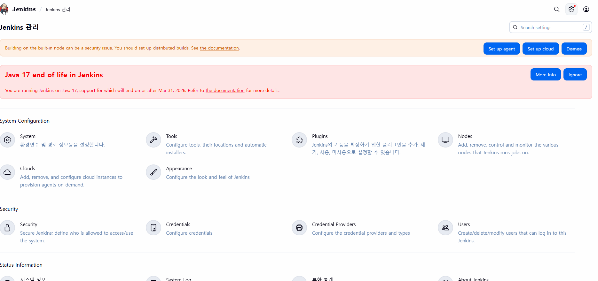
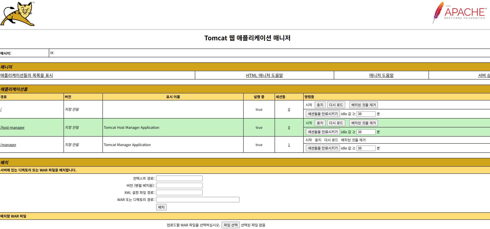

https://github.com/nobreak-labs/vagrant-environments/blob/main/Vagrantfile_jenkins_cicd


git: 버전 관리 도구
github: git이라는 도구를 사용하는 저장소 중 하나

```
git config --system
-> /etc/gitconfig
---> system all (global)

git config --global
-> ~/.gitconfig
---> user

git config --local
-> .git/config
---> workingDir
```

----

### git
```sh
vagrant@git-repo:~$ sudo apt update
vagrant@git-repo:~$ sudo apt install -y git

vagrant@git-repo:~$ git config --local user.name "local-name" 
fatal: --local can only be used inside a git repository

vagrant@git-repo:~$ git config --global user.name "global-name"

vagrant@git-repo:~$ ls -a ~
.  ..  .bash_logout  .bashrc  .cache  .gitconfig  .lesshst  .profile  .ssh  .sudo_as_admin_successful  .vbox_version

vagrant@git-repo:~$ cat .gitconfig
[user]
        name = global-name

vagrant@git-repo:~$ git config --system user.name "system-name"
error: could not lock config file /etc/gitconfig: Permission denied

vagrant@git-repo:~$ sudo git config --system user.name "system-name"
vagrant@git-repo:~$ ls -l /etc/gitconfig
-rw-r--r-- 1 root root 27 Jan 16 05:51 /etc/gitconfig
```

```sh
vagrant@git-repo:~/git-test$ git init
...
Initialized empty Git repository in /home/vagrant/git-test/.git/

vagrant@git-repo:~/git-test$ ls .git
branches  config  description  HEAD  hooks  info  objects  refs

vagrant@git-repo:~/git-test$ cat .git/config
[core]
        repositoryformatversion = 0
        filemode = true
        bare = false
        logallrefupdates = true

vagrant@git-repo:~/git-test$ git config --local  user.name "local-name-edit"
vagrant@git-repo:~/git-test$ git config --local  user.age 11
vagrant@git-repo:~/git-test$ cat .git/config
[core]
        repositoryformatversion = 0
        filemode = true
        bare = false
        logallrefupdates = true
[user]
        name = local-name-edit
        age = 11

vagrant@git-repo:~/git-test$ cat ~/.gitconfig 
[user]
        name = global-name
        email = my-email@a.com
vagrant@git-repo:~/git-test$ git config --list
user.name=system-name
user.name=global-name
user.email=my-email@a.com
core.repositoryformatversion=0
core.filemode=true
core.bare=false
core.logallrefupdates=true
user.name=local-name-edit
user.age=11
```

```sh
vagrant@git-repo:~/git-test$ git init
Reinitialized existing Git repository in /home/vagrant/git-test/.git/

vagrant@git-repo:~/git-test$ echo "Hello world" > test.txt
vagrant@git-repo:~/git-test$ ls
test.txt
vagrant@git-repo:~/git-test$ git status
On branch master

No commits yet

Untracked files:
  (use "git add <file>..." to include in what will be committed)
        test.txt

nothing added to commit but untracked files present (use "git add" to track)


vagrant@git-repo:~/git-test$ echo "Hello wooooooorld" >> test.txt
vagrant@git-repo:~/git-test$ git status
On branch master

No commits yet

Untracked files:
  (use "git add <file>..." to include in what will be committed)
        test.txt

nothing added to commit but untracked files present (use "git add" to track)
vagrant@git-repo:~/git-test$ git add .


vagrant@git-repo:~/git-test$ git status
On branch master

No commits yet

Changes to be committed:
  (use "git rm --cached <file>..." to unstage)
        new file:   test.txt

vagrant@git-repo:~/git-test$ git commit -m "new file create" 
[master (root-commit) 5c1f4e2] new file create
 1 file changed, 2 insertions(+)
 create mode 100644 test.txt


vagrant@git-repo:~/git-test$ git status
On branch master
nothing to commit, working tree clean

vagrant@git-repo:~/git-test$ git clone https://github.com/nobreak-labs/vagrant-environments.git
Cloning into 'vagrant-environments'...
remote: Enumerating objects: 226, done.
remote: Counting objects: 100% (226/226), done.
remote: Compressing objects: 100% (139/139), done.
remote: Total 226 (delta 137), reused 168 (delta 83), pack-reused 0 (from 0)
Receiving objects: 100% (226/226), 46.15 KiB | 6.59 MiB/s, done.
Resolving deltas: 100% (137/137), done.

vagrant@git-repo:~/git-test$ ls
test.txt  vagrant-environments

vagrant@git-repo:~/git-test$ ls -a vagrant-environments/
.  ..  docs  .git  .gitignore  README.md  scripts  templates  Vagrantfile_docker  Vagrantfile_frr  Vagrantfile_jenkins_cicd  Vagrantfile_kubespray  Vagrantfile_openstack_aio

vagrant@git-repo:~/git-test$ ls -a vagrant-environments/.git
.  ..  branches  config  description  HEAD  hooks  index  info  logs  objects  packed-refs  refs

vagrant@git-repo:~/git-test$ cat vagrant-environments/.git/config 
[core]
        repositoryformatversion = 0
        filemode = true
        bare = false
        logallrefupdates = true
[remote "origin"]
        url = https://github.com/nobreak-labs/vagrant-environments.git
        fetch = +refs/heads/*:refs/remotes/origin/*
[branch "main"]
        remote = origin
        merge = refs/heads/main

vagrant@git-repo:~/git-test$ git branch
* master
vagrant@git-repo:~/git-test$ git branch -M main

vagrant@git-repo:~/git-test$ git branch
* main
vagrant@git-repo:~/git-test$ git branch --list
* main

vagrant@git-repo:~/git-test$ git remote add origin https://github.com/alswn8268/cicd-test.git
vagrant@git-repo:~/git-test$ cat .git/config
[core]
        repositoryformatversion = 0
        filemode = true
        bare = false
        logallrefupdates = true
[user]
        name = local-name-edit
        age = 11
[remote "origin"]
        url = https://github.com/alswn8268/cicd-test.git
        fetch = +refs/heads/*:refs/remotes/origin/*

vagrant@git-repo:~/git-test$ git push -u origin main
Username for 'https://github.com': alswn8268 
Password for 'https://alswn8268@github.com': 
remote: Invalid username or token. Password authentication is not supported for Git operations.
fatal: Authentication failed for 'https://github.com/alswn8268/cicd-test.git/'

# github에서 token 발급 받기
vagrant@git-repo:~/git-test$ git push -u origin main
Username for 'https://github.com': alswn8268
Password for 'https://alswn8268@github.com': ***REMOVED_GITHUB_TOKEN*** 
Enumerating objects: 3, done.
Counting objects: 100% (3/3), done.
Writing objects: 100% (3/3), 229 bytes | 57.00 KiB/s, done.
Total 3 (delta 0), reused 0 (delta 0), pack-reused 0
To https://github.com/alswn8268/cicd-test.git
 * [new branch]      main -> main
Branch 'main' set up to track remote branch 'main' from 'origin'.


vagrant@git-repo:~/git-test$ ssh-keygen 
Generating public/private rsa key pair.
Enter file in which to save the key (/home/vagrant/.ssh/id_rsa): Enter passphrase (empty for no passphrase): 
Enter same passphrase again: 
Your identification has been saved in /home/vagrant/.ssh/id_rsa
Your public key has been saved in /home/vagrant/.ssh/id_rsa.pub
The key fingerprint is:
SHA256:qzR846Q4b3LJk6gjR0REY/8VzyeU+vuXTMIgpWcA8kU vagrant@git-repo
The key's randomart image is:
+---[RSA 3072]----+
| o= . .oE ..     |
| ..o o ..=o      |
| .  . . .=+ .    |
|  .  . .+ +o     |
| .    . S= o     |
|  .  .   .. o .  |
| .   o+o=  . + . |
|. o +oBB ..   +  |
| o.o.*+..  ...   |
+----[SHA256]-----+

vagrant@git-repo:~/git-test$ ls -l ~/.ssh
total 12
-rw------- 1 vagrant vagrant   89 Jan 16 05:00 authorized_keys
-rw------- 1 vagrant vagrant 2602 Jan 16 07:08 id_rsa
-rw-r--r-- 1 vagrant vagrant  570 Jan 16 07:08 id_rsa.pub

vagrant@git-repo:~/git-test$ cat ~/.ssh/id_rsa.pub 
ssh-rsa AAAAB3NzaC1yc2EAAAADAQABAAABgQCQnhhdB5pF0suRiKRZ9WD/thrxYMUCroYOurSsvL/C48qkzkmHr7vJ88GtlbRtAFoGbQk8tnWqjLKCX6pPp9Yvs/lMdX0c5N7FNKBaLNPELYdtS6PqXuUc2dypreAyMf2UoBxPT2HIlkPxWm1df0uMVGwcYzWSff+92NOjCnvV93kPnHgX2wubYG7NQxrrVVxDYzglp47PrBOMHVdPRqfNlmgFb4OXP+vkLvWf8eWA6UxO8U9gLq0EETkD22ttboTBIqc0I9mBXc7m7xr3UIL8pwSZRLFLZg/HoWWzwTAhbGg0yV66iZMzNGEDfnlLixjnKdBTL7b4vJn21YKuQGp+peR3+EqSieR33rOsNYreW06Dhas9jiRSttr+IrPGh5xJoReTvFk9y4r0LPrUwkwILkOoPAsK3wCYvhLNSHSULSsflrZJm+Iqtf/CuJtHCmh/mr19Ozz1KXn2SST4xCgtdjkGK1AEdPkmS5D9MifiwWu2NRG4qx1mEzkKZPa0wqE= vagrant@git-repo
```

```ssh
vagrant@git-repo:~/git-test$ git remote add ssh git@github.com:alswn8268/cicd-test.git
vagrant@git-repo:~/git-test$ cat .git/config 
[core]
        repositoryformatversion = 0
        filemode = true
        bare = false
        logallrefupdates = true
[user]
        name = local-name-edit
        age = 11
[remote "origin"]
        url = https://github.com/alswn8268/cicd-test.git
        fetch = +refs/heads/*:refs/remotes/origin/*
[branch "main"]
        remote = origin
        merge = refs/heads/main
[remote "ssh"]
        url = git@github.com:alswn8268/cicd-test.git
        fetch = +refs/heads/*:refs/remotes/ssh/*
vagrant@git-repo:~/git-test$ echo "test ssh" > newfile.txt
vagrant@git-repo:~/git-test$ git status 
On branch main
Your branch is up to date with 'origin/main'.

Untracked files:
  (use "git add <file>..." to include in what will be committed)
        newfile.txt
        vagrant-environments/

nothing added to commit but untracked files present (use "git add" to track)
vagrant@git-repo:~/git-test$ git add .
warning: adding embedded git repository: vagrant-environments
hint: You've added another git repository inside your current repository.
hint: Clones of the outer repository will not contain the contents of
hint: the embedded repository and will not know how to obtain it.
hint: If you meant to add a submodule, use:
hint:
hint:   git submodule add <url> vagrant-environments
hint:
hint: If you added this path by mistake, you can remove it from the
hint: index with:
hint:
hint:   git rm --cached vagrant-environments
hint:
hint: See "git help submodule" for more information.
vagrant@git-repo:~/git-test$ git status 
On branch main
Your branch is up to date with 'origin/main'.

Changes to be committed:
  (use "git restore --staged <file>..." to unstage)
        new file:   newfile.txt
        new file:   vagrant-environments

vagrant@git-repo:~/git-test$ git commit -m "push test"
[main b8e9b18] push test
 2 files changed, 2 insertions(+)
 create mode 100644 newfile.txt
 create mode 160000 vagrant-environments
vagrant@git-repo:~/git-test$ git push -u ssh main
The authenticity of host 'github.com (20.200.245.247)' can't be established.
ED25519 key fingerprint is SHA256:+DiY3wvvV6TuJJhbpZisF/zLDA0zPMSvHdkr4UvCOqU.
This key is not known by any other names
Are you sure you want to continue connecting (yes/no/[fingerprint])? yes
Warning: Permanently added 'github.com' (ED25519) to the list of known hosts.
Enumerating objects: 4, done.
Counting objects: 100% (4/4), done.
Delta compression using up to 2 threads
Compressing objects: 100% (2/2), done.
Writing objects: 100% (3/3), 328 bytes | 328.00 KiB/s, done.
Total 3 (delta 0), reused 0 (delta 0), pack-reused 0
To github.com:alswn8268/cicd-test.git
   5c1f4e2..b8e9b18  main -> main
Branch 'main' set up to track remote branch 'main' from 'ssh'.


vagrant@git-repo:~/git-test$ rm -rf vagrant-environments/
vagrant@git-repo:~/git-test$ ls
newfile.txt  test.txt
vagrant@git-repo:~/git-test$ git add .
vagrant@git-repo:~/git-test$ git commit -m "remove dir"
[main 0d39953] remove dir
 1 file changed, 1 deletion(-)
 delete mode 160000 vagrant-environments
vagrant@git-repo:~/git-test$ git push
Enumerating objects: 3, done.
Counting objects: 100% (3/3), done.
Delta compression using up to 2 threads
Compressing objects: 100% (2/2), done.
Writing objects: 100% (2/2), 214 bytes | 107.00 KiB/s, done.
Total 2 (delta 1), reused 0 (delta 0), pack-reused 0
remote: Resolving deltas: 100% (1/1), completed with 1 local object.
To github.com:alswn8268/cicd-test.git
   b8e9b18..0d39953  main -> main
```


### jenkins

```sh
vagrant@jenkins:~$ sudo apt update
vagrant@jenkins:~$ sudo apt install -y fontconfig openjdk-17-jre
vagrant@jenkins:~$ java -version
openjdk version "17.0.17" 2025-10-21
OpenJDK Runtime Environment (build 17.0.17+10-Ubuntu-122.04)
OpenJDK 64-Bit Server VM (build 17.0.17+10-Ubuntu-122.04, mixed mode, sharing)

vagrant@jenkins:~$ sudo wget -O /etc/apt/keyrings/jenkins-keyring.asc   https://pkg.jenkins.io/debian-stable/jenkins.io-2023.key
vagrant@jenkins:~$ ls -l /etc/apt/keyrings/jenkins-keyring.asc 
-rw-r--r-- 1 root root 3175 Mar 28  2023 /etc/apt/keyrings/jenkins-keyring.asc

vagrant@jenkins:~$ echo "deb [signed-by=/etc/apt/keyrings/jenkins-keyring.asc]"   https://pkg.jenkins.io/debian-stable binary/ | sudo tee   /etc/apt/sources.list.d/jenkins.list > /dev/null
vagrant@jenkins:~$ cat /etc/apt/sources.list.d/jenkins.list 
deb [signed-by=/etc/apt/keyrings/jenkins-keyring.asc] https://pkg.jenkins.io/debian-stable binary/

vagrant@jenkins:~$ sudo apt update
vagrant@jenkins:~$ sudo apt install -y jenkins

vagrant@jenkins:~$ ip addr show enp0s8
3: enp0s8: <BROADCAST,MULTICAST,UP,LOWER_UP> mtu 1500 qdisc fq_codel state UP group default qlen 1000
    link/ether 08:00:27:03:08:ad brd ff:ff:ff:ff:ff:ff
    inet 192.168.56.101/24 brd 192.168.56.255 scope global enp0s8
       valid_lft forever preferred_lft forever
    inet6 fe80::a00:27ff:fe03:8ad/64 scope link
       valid_lft forever preferred_lft forever

# http://192.168.56.101:8080/login?from=%2F 접속

vagrant@jenkins:~$ sudo cat /var/lib/jenkins/secrets/initialAdminPassword
5285cbee084a44f7bd016f2e1f8bb867

# 패스워드 입력 -> Install Suggested Plugin
# Create First Admin User (admin - 1 - 1 - kmj - kmj@a.a) -> Save and Continue
# Instance Configuration -> Save and Finish 
# Start Using Jenkins
```



```
Jenkins 관리

# New Item 탭
Enter an item name: first-project
Select an item type: Freestyle Project
OK

# Build Steps 탭
Add build step -> Execute shell
Command: echo "Hello World" > hello.txt
Save (Apply)

# 지금 빌드 탭

# #n 버튼 눌러서 빌드 정보 확인

vagrant@jenkins:~$ sudo cat /var/lib/jenkins/workspace/first-project/hello.txt
Hello World
```

```sh
vagrant@jenkins:~$ sudo apt install -y maven
vagrant@jenkins:~$ mvn --version
Apache Maven 3.6.3
```

```
# Jenkins 관리
Tools
JDK installations -> Add JDK
  Name: java-17
  JAVA_HOME: /usr/lib/jvm/java-17-openjdk-amd64  (mvn --version 으로 확인)
  
Maven installations -> Add Maven
  Name: mvn-3
  MAVEN_HOME: /usr/share/maven
  Install automatically 체크 해제

SAVE


Plugins
Available plugins
  Maven Integration -> Install
  메인 페이지로 돌아가기

New Item
  - second-project
  - Maven Project
Save

소스 코드 관리 -> Git
  Repository URL: https://github.com/nobreak-labs/source-maven-java-spring-hello-webapp.git
  Branch Specifier: */main

Build
  Goals and options: clean package
SAVE

지금 빌드
```
```sh
vagrant@jenkins:~$ git clone https://github.com/nobreak-labs/source-maven-java-spring-hello-webapp.git
vagrant@jenkins:~$ cd source-maven-java-spring-hello-webapp/

vagrant@jenkins:~/source-maven-java-spring-hello-webapp$ ls -a
.  ..  .git  .gitignore  pom.xml  README.md  src
vagrant@jenkins:~/source-maven-java-spring-hello-webapp$ rm -rf .git
vagrant@jenkins:~/source-maven-java-spring-hello-webapp$ git init
vagrant@jenkins:~/source-maven-java-spring-hello-webapp$ git add .
vagrant@jenkins:~/source-maven-java-spring-hello-webapp$ git commit -m "test"

vagrant@jenkins:~/source-maven-java-spring-hello-webapp$ git remote add origin xxxxxxxx 

vagrant@jenkins:~/source-maven-java-spring-hello-webapp$ ssh vagrant@192.168.56.102 sudo apt update
yes
vagrant

vagrant@jenkins:~/source-maven-java-spring-hello-webapp$ ssh vagrant@192.168.56.102 sudo apt install -y tomcat9 tomcat9-admin
vagrant
```

```
git으로 이동
Create a new fork
```

```sh
vagrant@tomcat:~$ sudo apt update
vagrant@tomcat:~$ sudo apt install -y tomcat9 tomcat9-admin
vagrant@tomcat:~$ sudo systemctl status tomcat9.service

vagrant@tomcat:~$ sudo vim /etc/tomcat9/tomcat-users.xml

  <role rolename="manager-gui"/>
  <role rolename="manager-script"/>
  <role rolename="manager-jmx"/>
  <role rolename="manager-status"/>

  <user username="admin" password="P@ssw0rd" roles="manager-gui,manager-script,manager-jmx,manager-status"/>

vagrant@tomcat:~$ sudo systemctl restart tomcat9.service

# http://192.168.56.102:8080/manager/html 접속
# ID: admin / PW: P@ssw0rd
```



인증 권한 설정
``` 
Jenkins 관리 - Plugins
Available plugins
  Deploy to container -> Install

Jenkins 관리 - Credentials
Global
adding some credentials?
  Username: admin
  Password: P@ssw0rd
  ID: tomcat

Create


메인 화면
second-project -> 구성
빌드 후 조치
  빌드 후 조치 추가
  Deploy war/ear to a container -> target/hello-world.war
  Containers -> Tomcat 9.x Remote
    Credentials -> admin/******
    Tomcat URL -> http://192.168.56.102:8080

Save

지금 빌드
```

```sh
vagrant@tomcat:~$ sudo apt update
vagrant@tomcat:~$ sudo apt install -y openjdk-17-jre tomcat9 tomcat9-admin

vagrant@tomcat:~$ JDK_PATH=$(readlink -f /usr/bin/java | awk -F'/bin/java' '{print $1}')
vagrant@tomcat:~$ sudo sed -i "/^#JAVA_HOME/ c\JAVA_HOME=${JDK_PATH}" /etc/default/tomcat9
# vagrant@tomcat:~$ JAVA_HOME=/usr/lib/jvm/java-17-openjdk-amd64

vagrant@tomcat:~$ sudo systemctl restart tomcat9

http://192.168.56.102:8080/hello-world/ 접속
```

#### 자동
```sh
vagrant@git-repo:~/source-maven-java-spring-hello-webapp$ git status
On branch main
Your branch is up to date with 'origin/main'.

nothing to commit, working tree clean

vagrant@git-repo:~/source-maven-java-spring-hello-webapp$ vim Jenkinsfile

pipeline {
  agent any

  triggers {
    pollSCM('* * * * *')
  }

  stages {
    stage('Checkout') {
      steps {
        git branch: 'main',
        url: 'https://github.com/alswn8268/source-maven-java-spring-hello-webapp.git'
      }
    }
    stage('Build') {
      steps {
        sh 'mvn clean package'
      }
    }
    stage ('Deploy') {
      steps {
        deploy adapters: [tomcat9(credentialsId: 'tomcat', url: 'http://192.168.56.102:8080')], contextPath: null, war: 'target/hello-world.war'
      }
    }
  }
}

vagrant@git-repo:~/source-maven-java-spring-hello-webapp$ git add .
vagrant@git-repo:~/source-maven-java-spring-hello-webapp$ git commit -m "Create Jenkinsfile"
vagrant@git-repo:~/source-maven-java-spring-hello-webapp$ git push
```

```sh
New Item
  Enter an item name: pipeline-project
  Pipeline 버튼
OK

Pipeline
  Definition: Pipeline script from SCM
  SCM: Git
  Repository URL: https://github.com/alswn8268/source-maven-java-spring-hello-webapp.git
  Branch Specifier: */main
  Script Path: Jenkinsfile
```

```sh
vagrant@jenkins-node:~$ sudo apt update
vagrant@jenkins-node:~$ sudo apt install -y openjdk-17-jre maven

vagrant@jenkins-node:~$ sudo useradd -m -d /var/lib/jenkins jenkins
vagrant@jenkins-node:~$ grep jenkins /etc/passwd
jenkins:x:1001:1001::/var/lib/jenkins:/bin/sh

vagrant@jenkins-node:~$ sudo passwd jenkins 
New password: jenkins
Retype new password: jenkins
```

```
Jenkins 관리 -> Nodes -> New Node
  Name: jenkins-node
  Number of executors: 1
  Labels: maven

```

----
개발 과정
1. 소스 코드 작성 (개별적)                  -> 개발자들의 노트북 등에서 작업
2. 버전 관리 시스템을 통해서 취합              -> github 등의 저장소를 사용
3. 최종본을 통해서 빌드 작업을 수행            -> 빌드 도구가 설치되어 있는 시스템
4. 결과물(바이너리 파일 등)을 실제 서버에 배포    -> 운영 중인 특정 서버로 배포

실습 기준 순서
1. git-repo 가상머신에서 코드 작성
2. 해당 코드를 github 저장소에 푸시
3. 저장소의 파일을 다운로드
4. Maven(빌드 도구)으로 빌드 작업을 수행
5. hello-world.war(결과물)를 Tomcat 서버에 배포

젠킨스를 이용해서 작업할 경우
1. 1, 2번 작업은 동일
2. jenkins 가상머신에 jenkins와 maven 도구 설치
3. jenkins 대시보드에서 플러그인 설치 및 환경변수 설정 + 자격증명 설정
4. 실제 작업할 내용을 maven 프로젝트 라는 형식으로 설정
  (코드를 다운로드할 저장소 및 배포할 서버에 대한 설정을 작성)
5. 빌드 버튼을 누르거나 혹은 설정에 따라 주기적으로 체크하면서 자동 실행
  -> 빌드 후 톰캣 서버에 배포까지 함께 완료

젠킨스에서 Jenkinsfile을 통해서 작업하는 경우
위 기준 4번 항목에서 pipeline 프로젝트 방식으로 설정
  *+* Jenkinsfile을 작성해서 실행 (파일 안에 작업할 내용을 단계적으로 작성)

---

### 젠킨스 실습 가이드

0. 모든 가상머신 초기화 후 실습
```sh
vagrant destroy -f
```
1. 젠킨스 없이 수동으로 빌드하는 방법 확인하기
    1. git-repo , tomcat 가상머신 부팅
        ```sh
        vagrant up git-repo
        vagrant up tomcat
        ```
    2. git-repo 가상머신에서 SSH키 생성 후 Github 에 키추가
        ```sh
        vagrant@git-repo:~$ sudo apt update
        vagrant@git-repo:~$ sudo apt install -y git
        vagrant@git-repo:~$ ssh-keygen

        vagrant@git-repo:~$ cat ~/.ssh/id_rsa.pub
        ssh-rsa AAAAB3NzaC1yc2EAAAADAQABAAABgQDUsjqZsE2ateKHJ3blppBNjjiJchoHcgCmDe4gX9iLPL5abYYdAaOMUFxIzWJESANoqYynEzIcHrJf7RHfuma7wdv11qE2c0sQ5+MAI4l38FCA+z//1LWuT8l+oevrfH9D92NSIM4I5YfES2cOuj4/rDqbqcj3fQD143YVNuSg2DUePN7Hq8SB1f3XetIuREOSp9EiPkREnAZVQ4Eo4jCZdpUqrAFGVMqmyd8M8/z7FcVwBkdKDoySODEXO/2a+p6Lm0Sm3KdgkyTc/Sy3dQ3SCr0KywLeBuDIgN4BDhkcJqHL6i2PR0X0DHoC19zOVqa0bH1hc4owb7yF4JvMtjAX39z1s4HIMLL3UX1C0wSADjZZ2kA6BMAz/8ERKXMWItgUmbImhdmAcAwds3TFni14J/znhT7Th+1JSl866U0856hg3P/g9J1aQDAPPNM5QPOMpfB2mt7C4LblIOhHmePcM6T/6KBJozNPAUmXpGEZ0uexDJoE0mTsn0Ly+02S+8E= vagrant@git-repo

        # github 접속 -> settings -> SSH and GPG keys -> SSH keys -> New SSH Key -> ssh-rsa~= 까지 입력 후 등록
        ```
    3. 소스코드가 있는 깃 저장소를 가상머신에 복제
        ```sh
        vagrant@git-repo:~$ git clone git@github.com:alswn8268/source-maven-java-spring-hello-webapp.git
        ```
    4. 가상머신에 openjdk-17-jre , maven  패키지 설치
        ```sh
        vagrant@git-repo:~$ sudo apt update
        vagrant@git-repo:~$ sudo apt install -y openjdk-17-jdk maven
        ```
    5. mvn clean package 명령어 실행 (빌드작업)
        ```sh
        vagrant@git-repo:~/source-maven-java-spring-hello-webapp$ mvn clean package
        ```
    6. tomcat 가상머신에 openjdk-17-jre , tomcat9 , tomcat9-admin 패키지 설치
        ```sh
        vagrant@tomcat:~$ sudo apt update
        vagrant@git-repo:~$ sudo apt install -y openjdk-17-jre tomcat9 tomcat9-admin
        ```
    7. /etc/tomcat9/tomcat-users.xml 파일과 /etc/default/tomcat9 수정 및 서비스 재시작 (설치가이드 참고)
        ```sh
        vagrant@tomcat:~$ JDK_PATH=$(readlink -f /usr/bin/java | awk -F'/bin/java' '{print $1}')
        vagrant@tomcat:~$ sudo sed -i "/^#JAVA_HOME/ c\JAVA_HOME=${JDK_PATH}" /etc/default/tomcat9
        vagrant@tomcat:~$ sudo systemctl restart tomcat9
        
        vagrant@tomcat:~$ sudo vim /etc/tomcat9/tomcat-users.xml

          <role rolename="manager-gui"/>
          <role rolename="manager-jmx"/>
          <role rolename="manager-script"/>
          <role rolename="manager-status"/>
          <user username="admin" password="P@ssw0rd" roles="manager-gui,manager-jmx,manager-script,manager-status"/>

        vagrant@tomcat:~$ sudo systemctl restart tomcat9
        ```

    8. tomcat 가상머신 IP주소 (http://192.168.56.102:8080) 확인해서 접속해보기
        ```sh
        It works !
        ```
    9. git-repo 가상머신에서 hello-world.war 파일을 tomcat 가상머신에 /var/lib/tomcat9/webapp 디렉토리에 복사하기
        ```sh
        vagrant@git-repo:~$ scp source-maven-java-spring-hello-webapp/target/hello-world.war vagrant@192.168.56.102:/tmp/
        yes
        vagrant
        hello-world.war    
        ```
    10. 복사한 위치에서 hello-world 디렉토리 생성되는지 확인해보기
        ```sh
        vagrant@tomcat:~$ sudo mv /tmp/hello-world.war /var/lib/tomcat9/webapps/
        vagrant@tomcat:~$ ls /var/lib/tomcat9/webapps/
        hello-world  hello-world.war  ROOT
        ```
    11. http://192.168.56.102:8080/hello-world 로 접속해보기
        ```sh
        Hello World
        Today is 2026-01-20
        Version: 1.0
        ```
    12. 잘되면 복사했던 hello-world.war 파일과 hello-world 디렉토리 삭제하고 다음 단계 실습 진행
        ```sh
        vagrant@tomcat:/var/lib/tomcat9/webapps$ ls
        hello-world  hello-world.war  ROOT
        vagrant@tomcat:/var/lib/tomcat9/webapps$ sudo rm -f hello-world.war
        vagrant@tomcat:/var/lib/tomcat9/webapps$ sudo rm -rf hello-world/
        vagrant@tomcat:/var/lib/tomcat9/webapps$ ls
        ROOT
        ```

2. 젠킨스 설치하고 작업해보기
    1. jenkins 가상머신 생성
        ```sh
        vagrant up jenkins
        vagrant ssh jenkins
        ```
    2. jenkins 가상머신에 openjdk-17-jre , jenkins 패키지 설치하기 (설치가이드 참고)
        ```sh
        vagrant@jenkins:~$ sudo apt update
        vagrant@jenkins:~$ sudo apt install -y fontconfig openjdk-17-jre


        ```
    3. 대시보드에 접속해서 플러그인 설치 및 사용자계정 생성
        ```sh

        ```
    4. 젠킨스 관리 > tools 에서 jdk와 maven 환경변수 설정
        ```sh

        ```
    5. 젠킨스 관리 > plugin 에서 maven integration , deploy to container 플러그인 설치
        ```sh

        ```
    6. 젠킨스 관리 > credentials 에서 톰캣서버에 대한 자격증명 생성
        ```sh

        ```
    7. 새 아이템 생성 에서 maven 프로젝트 종류 선택 후 설정
        ```sh

        ```
    8. 지금 빌드 버튼 눌러서 빌드해보고 톰캣서버에 접속해서 결과 확인하기
        ```sh

        ```
    9. 잘되면 복사된 hello-world.war 파일과 hello-world 디렉토리 삭제하고 다음 단계 실습 진행
        ```sh

        ```

3. 젠킨스파일을 작성해서 pipeline 방식으로 실습 진행하기
    1. git–repo 가상머신에서 앞에 실습(1-3)에서 복사한 파일들 중 Jenkinsfile 만 삭제(혹은 다른곳으로 이동) 후 github에 푸시하고 확인해보기
    2. 새로운 Jenkinsfile 을 작성하기 (p.69-70 혹은 어제 만든파일 참고, 저장소 주소는 본인 github주소 사용)
    3. 새로운 github 저장소 생성 후 해당 저장소에 Jenkinsfile만 push해보기
    4. 젠킨스 대시보드에서 새 아이템 생성으로 pipeline 프로젝트 선택
    5. Jenkinsfile 을 가져올 때 주소를 새로 생성한 저장소 주소를 지정
    6. 빌드버튼을 눌러서 실행 후 톰캣에 접속해서 확인해보기
    7. git-repo 가상머신에서 복제한 저장소 위치에 있는 파일 중, 
    8. source-maven-java-spring-hello-webapp/src/main/webapp/WEB-INF/views/index.jsp
    9. 파일 내용 편집 후 푸시하기  `(ex. <h3>Version: 1.0</h3> -> <h3>Version: 2.0</h3>)`
    10. 푸시하고나서 젠킨스 대시보드에서 빌드버튼은 누르지말고 프로젝트 지켜보기있기 (자동빌드)
    11. 자동으로 빌드가 되면 완료된 후 다시 접속해서 결과 확인해보기

---


### 도커
---
도커에서 젠킨스 설치
도커 환경에서의 젠킨스 기본적인 동작 방식이

1. 젠킨스를 통해 소스 코드를 빌드해서 실행 파일을 생성
2. 실행 파일을 포함한 컨테이너 이미지를 생성
3. 이미지를 도커 허브 등의 저장소에 저장
4. 해당 이미지를 컨테이너로 실행
그러기 위해서는 젠킨스가 docker 명령어를 사용해야 함

방식 1. Docker In Docker
방식 2. Docker Out Of Docker

---

```sh
# Add Docker's official GPG key:
sudo apt update
sudo apt install ca-certificates curl
sudo install -m 0755 -d /etc/apt/keyrings
sudo curl -fsSL https://download.docker.com/linux/ubuntu/gpg -o /etc/apt/keyrings/docker.asc
sudo chmod a+r /etc/apt/keyrings/docker.asc

# Add the repository to Apt sources:
sudo tee /etc/apt/sources.list.d/docker.sources <<EOF
Types: deb
URIs: https://download.docker.com/linux/ubuntu
Suites: $(. /etc/os-release && echo "${UBUNTU_CODENAME:-$VERSION_CODENAME}")
Components: stable
Signed-By: /etc/apt/keyrings/docker.asc
EOF

sudo apt update

sudo apt install docker-ce docker-ce-cli containerd.io docker-buildx-plugin docker-compose-plugin

vagrant@docker:~$ sudo usermod -aG docker vagrant

exit
```

```sh
vagrant@docker:~$ docker ps
CONTAINER ID   IMAGE     COMMAND   CREATED   STATUS    PORTS     NAMES

vagrant@docker:~$ docker network create jenkins
c506e9d02e34bca8d8d6aa1616edabefbcc15c25902bbab994b9646f9a373e72

vagrant@docker:~$ docker run \
  --name jenkins-docker \
  --restart=always \
  -d \
  --network jenkins \
  --network-alias docker \
  --privileged \
  --env DOCKER_TLS_CERTDIR=/certs \
  --volume jenkins-docker-certs:/certs/client \
  --volume jenkins-data:/var/jenkins_home \
  -p 2376:2376 \
  docker:dind \
  --storage-driver overlay2
f8ce9c764ee76ba1265cd728dede045b98ea6d338a7a70a085a49a2e6bf6ae65

vagrant@docker:~$ docker images
IMAGE         ID             DISK USAGE   CONTENT SIZE   EXTRA
docker:dind   3a33fc81fa4d        508MB          136MB    U 

vagrant@docker:~$ vim Dockerfile
FROM jenkins/jenkins:2.528.3-jdk21
USER root
RUN apt-get update && apt-get install -y lsb-release ca-certificates curl && \
    install -m 0755 -d /etc/apt/keyrings && \
    curl -fsSL https://download.docker.com/linux/debian/gpg -o /etc/apt/keyrings/docker.asc && \
    chmod a+r /etc/apt/keyrings/docker.asc && \
    echo "deb [arch=$(dpkg --print-architecture) signed-by=/etc/apt/keyrings/docker.asc] \
    https://download.docker.com/linux/debian $(. /etc/os-release && echo \"$VERSION_CODENAME\") stable" \
    | tee /etc/apt/sources.list.d/docker.list > /dev/null && \
    apt-get update && apt-get install -y docker-ce-cli && \
    apt-get clean && rm -rf /var/lib/apt/lists/*
USER jenkins
RUN jenkins-plugin-cli --plugins "blueocean docker-workflow json-path-api"

vagrant@docker:~$ docker build -t myjenkins-blueocean:2.528.3-1 .

vagrant@docker:~$ docker exec jenkins-blueocean cat /var/jenkins_home/secrets/initialAdminPassword
82be33ec5cde45d6af07d81c06d5019b
```

```sh
# http://192.168.56.104:8080/ 접속

vagrant@docker:~$ mkdir myweb
vagrant@docker:~$ cd myweb
vagrant@docker:~/myweb$ vim Dockerfile

FROM    maven:3-openjdk-17 AS mbuilder
RUN     mkdir /hello
RUN     git clone https://github.com/alswn8268/source-maven-java-spring-hello-webapp.git /hello
WORKDIR /hello
RUN     mvn package
FROM    tomcat:9-jre17
COPY    --from=mbuilder /hello/target/hello-world.war /usr/local/tomcat/webapps/

vagrant@docker:~/myweb$ docker image build -t myhello .

 => => unpacking to docker.io/library/myhello:latest                                                                                                                                                         0.1s 
vagrant@docker:~/myweb$ docker container run -d -p 80:8080 --name myweb myhello:latest 
4f321fd78a0f53bc231d78133587b048b8f2f64e242b63668726b5d66774ca99

vagrant@docker:~/myweb$ docker ps
CONTAINER ID   IMAGE                           COMMAND                  CREATED          STATUS          PORTS                                                                                          NAMES
4f321fd78a0f   myhello:latest                  "catalina.sh run"        5 seconds ago    Up 5 seconds    0.0.0.0:80->8080/tcp, [::]:80->8080/tcp                                                        myweb     
8d1b9e78f414   myjenkins-blueocean:2.528.3-1   "/usr/bin/tini -- /u…"   15 minutes ago   Up 15 minutes   0.0.0.0:8080->8080/tcp, [::]:8080->8080/tcp, 0.0.0.0:50000->50000/tcp, [::]:50000->50000/tcp   jenkins-blueocean
f8ce9c764ee7   docker:dind                     "dockerd-entrypoint.…"   52 minutes ago   Up 52 minutes   2375/tcp, 0.0.0.0:2376->2376/tcp, [::]:2376->2376/tcp        

# http://192.168.56.104/hello-world/ 접속
Hello World
Today is 2026-01-20
Version: 1.0
```

```
Jenkins 관리 -> Clouds
Install a plugin
Docker 검색 -> Install

Jenkins 관리 -> Clouds -> New cloud
New cloud
  Cloud name: docker
  Type: Docker
Create

New cloud
  Docker Cloud Details
    Docker Host URI: tcp://docker:2376
    Server credentials: +Add -> Jenkins
      Kind: X.509 Client Certificate
      Client Key -> Add 
        Secret 입력 (docker exec jenkins-docker cat /certs/client/key.pem 에 있는 값)
        Client Certificate (docker exec jenkins-docker cat /certs/client/cert.pem 에 있는 값)
        Server CA Certificate (docker exec jenkins-docker cat /certs/client/ca.pem 에 있는 값)
      ID: docker-client-certs
    -> Add -> docker-client-certs 선택 -> Test Connection
    Enabled 체크
    Docker Agent templates -> Add Docker Template
      Labels: docker
      Enabled 체크
      Name: docker-agent
      Docker Image: jenkins/agent
Save
```

```sh
vagrant@git-repo:~/source-maven-java-spring-hello-webapp$ vim Jenkinsfile-docker

pipeline {
  agent none
  
  stages {
    stage('CheckOut') {
      agent any
      steps {
        git branch: 'main',
        url: https://github.com/alswn8268/source-maven-java-spring-hello-webapp.git
      }
    }
    stage('Build') {
      agent{
        docker { image 'maven:3-openjdk-17' }
      }
      steps {
        sh 'mvn clean package'
      }
    }
    stage('Image Build') {
      agent any
      steps {
        sh 'docker image build -t tomcat:hello .'
      }
    }
    stage('Image Tag') {
      agent any
      steps {
        sh 'docker image tag tomcat:hello kmj/tomcat:$BUILDNUMBER'
        sh 'docker image tag tomcat:hello kmj/tomcat:latest'
      }
    }
    stage('Image Path') {
      agent any
      steps {
        withDockerRegistry(credentialsId: 'docker-hub-token', url: 'https://index.docker.io/v1/') {
          sh 'docker image push kmj/tomcat:$BUILDNUMBER'
          sh 'docker image push kmj/tomcat:latest'
        }
      }
    }
    stage('Running Container') {
      agent {
        docker { image 'docker:dind' }
      }
      steps {
        sh 'docker -H tcp://192.168.56.103:2375 run -d --name webserver -p 80:8080 kmj/tomcat:latest'
      }
    }
  }
}


vagrant@git-repo:~/source-maven-java-spring-hello-webapp$ vim Dockerfile
FROM  tomcat:9-jre17
COPY  target/hello-world.war  /usr/local/tomcat/webapps

vagrant@git-repo:~/source-maven-java-spring-hello-webapp$ git add .
vagrant@git-repo:~/source-maven-java-spring-hello-webapp$ git commit -m "create docker jenkins"
vagrant@git-repo:~/source-maven-java-spring-hello-webapp$ git push
```

```
docker hub 로그인
https://app.docker.com/accounts/alswn8268/settings/personal-access-tokens -> Generate new token
Create access token
  Access token description: cicd-token
  Expiration date: Custom
  Access permissions: Read, Write, Delete
Generate

Jenkins로 이동
Jenkins 관리 -> Credentials
Global
Add Credentials
  Username: kmj
  Password: (docker hub의 Password 값)
Create
```

```sh
vagrant@docker:~/myweb$ sudo systemctl edit docker.service

ExecStart=
ExecStart=/usr/bin/dockerd -H fd:// -H tcp://0.0.0.0:2375 --containerd=/run/containerd/containerd.sock

vagrant@docker:~/myweb$ sudo systemctl daemon-reload
vagrant@docker:~/myweb$ sudo systemctl restart docker.service
vagrant@docker:~/myweb$ docker ps
CONTAINER ID   IMAGE                           COMMAND                  CREATED       STATUS         PORTS                                                                                          NAMES
8d1b9e78f414   myjenkins-blueocean:2.528.3-1   "/usr/bin/tini -- /u…"   2 hours ago   Up 2 seconds   0.0.0.0:8080->8080/tcp, [::]:8080->8080/tcp, 0.0.0.0:50000->50000/tcp, [::]:50000->50000/tcp   jenkins-blueocean
f8ce9c764ee7   docker:dind                     "dockerd-entrypoint.…"   2 hours ago   Up 2 seconds   2375/tcp, 0.0.0.0:2376->2376/tcp, [::]:2376->2376/tcp   

vagrant@docker:~/myweb$ sudo vim /lib/systemd/system/docker.service
ExecStart=/usr/bin/dockerd -H fd:// -H tcp:0.0.0.0:2375 --containerd=/run/containerd/containerd.sock


```

```
Jenkins - New Item
Enter an item name: docker-project
  Pipeline
Create

Pipeline
  Definition -> Pipelin script from SCM
  SCM -> Git
  Repository URL -> https://github.com/alswn8268/source-maven-java-spring-hello-webapp.git
  Branch Specifier -> */main
  Jenkinsfile-docker
Save
``` 

----
일반적인 개발 과정 (tomcat 서버 구성 기준)
1. 코드 작성 (코딩 도구가 있는 시스템)
2. Github에 푸시
3. 코드 다운로드 후 빌드 (빌드 도구(maven)가 있는 시스템)
4. 생성된 애플리케이션을 실제 운영 서버에 배포 (tomcat 서버)

Jenkins를 사용하는 경우 (온프레미스)
1. 코드 작성
2. Github 푸시
3. Jenkins 시스템을 준비
    1) Jenkins-Controller를 설치 (패키지 형식으로 설치 -> openjdk-jre-17 jenkins)
    2) 플러그인 설치, 대시보드 사용자 설정, 자격증명, 환경변수 ... -> 대시보드에서
    3) 새로운 아이템 생성 (freestyle / maven / pipeline)
    4) pipeline 프로젝트의 경우 Jenkinsfile 작성이 필요 (직접 작성 / github에서 다운)
    5) 빌드 작업 실행 (수동 실행 혹은 trigger 설정으로 자동 실행 가능)
4. tomcat 서버 (운영 서버) 준비
    1) 패키지 설치 (openjdk-jre-17, tomcat9, tomcat9-admin)
    2) 사용자 및 권한 설정 (/etc/tomcat9/tomcat-users.xml -> systemctl restart tomcat9)

Jenkins를 사용하는 경우 (도커)
1. 구성 방식 선택 -> docker in docker / docker out of docker
2. 코드 작성 (Jenkinsfile)
3. GitHub 푸시
4. Jenkins 및 Docker 이미지를 작성하고 컨테이너로 실행
5. Jenkins 컨테이너로 접속(대시보드) 후 작업
6. Tomcat 서버도 이미지를 작성해서 컨테이너로 실행 ( + 도커 서비스 설정 추가)

----

### 앤서블
```sh
vagrant@docker:~/myweb$ sudo apt update
vagrant@docker:~/myweb$ sudo apt install -y software-properties-common
vagrant@docker:~/myweb$ sudo add-apt-repository --yes --update ppa:ansible/ansible
vagrant@docker:~/myweb$ sudo apt install -y ansible

vagrant@docker:~/myweb$ sudo apt install -y python3-docker
vagrant@docker:~/myweb$ ansible localhost -m docker_container -a "name=myapache image=httpd:2.2 state=started"


vagrant@git-repo:~/source-maven-java-spring-hello-webapp$ vim playbook.yaml

- hosts: localhost
  connection: local
  
  tasks:
  - name: Create & Start Container
    docker_container:
      name: myweb
      image: "kmj/tomcat:latest"
      state: started
      ports:
      - "80:8080"


vagrant@git-repo:~/source-maven-java-spring-hello-webapp$ cp Jenkinsfile-docker Jenkinsfile-docker-ansible
vagrant@git-repo:~/source-maven-java-spring-hello-webapp$ vim Jenkinsfile-docker-ansible

vagrant@git-repo:~/source-maven-java-spring-hello-webapp$ git add .
vagrant@git-repo:~/source-maven-java-spring-hello-webapp$ git commit -m "Create Jenkinsfile"
vagrant@git-repo:~/source-maven-java-spring-hello-webapp$ git push
```

```
Jenkins 관리
Plugins -> availagle plugins -> ansible -> install

New Item
  Name: docker_ansible
  pipeline
Create

Triggers - pipeline
  Definition: Pipeline script from SCM
  SCM: Git
  Repository: ~.git
  Branch: */main
  Script Path: Jenkinsfile-docker-ansible
Save

Tools
Add Ansible
  Name: ansible
  Install Automatically 체크

Add Docker
  Name: docker
  Install Automatically 체크
  
```

```sh
vagrant@docker:~$ vim Dockerfile

FROM jenkins/jenkins:lts-jdk17
USER root
RUN apt-get update && apt-get install -y ca-certificates curl && install -m 0755 -d /etc/apt/keyrings && curl -fsSL https://download.docker.com/linux/debian/gpg -o /etc/apt/keyrings/docker.asc && chmod a+r /etc/apt/keyrings/docker.asc
RUN echo \
  "deb [arch=$(dpkg --print-architecture) signed-by=/etc/apt/keyrings/docker.asc] https://download.docker.com/linux/debian \
  $(. /etc/os-release && echo "$VERSION_CODENAME") stable" | \
  tee /etc/apt/sources.list.d/docker.list > /dev/null
RUN apt-get update && apt install -y docker-ce-cli ansible
USER jenkins
RUN jenkins-plugin-cli --plugins "git pipeline-stage-view docker-plugin docker-workflow ansible"

vagrant@docker:~$ docker image build -t new-jenkins .
vagrant@docker:~$ docker container run --name jenkins \
  --restart=always \
  --detach \
  --network jenkins \
  --env DOCKER_HOST=tcp://192.168.56.104:2376 \
  --env DOCKER_TLS_VERIFY=1 \
  --env DOCKER_CERT_PATH=/var/jenkins_home/.docker \
  --publish 8080:8080 \
  --volume jenkins-data:/var/jenkins_home \
  --volume ~/docker-client-tls:/var/jenkins_home/.docker \
  new-jenkins

vagrant@docker:~$ docker container stop jenkins-blueocean 
vagrant@docker:~$ docker container rm jenkins-blueocean 

vagrant@docker:~$ docker container run --name jenkins   --restart=always   --detach   --network jenkins   --env DOCKER_HOST=tcp://docker:2376   --env DOCKER_TLS_VERIFY=1   --env DOCKER_CERT_PATH=/certs/client   --publish 8080:8080 --publish 50000:50000   --volume jenkins-data:/var/jenkins_home   --volume jenkins-docker-certs:/certs/client:ro   new-jenkins

vagrant@docker:~$ docker exec jenkins docker ps
vagrant@docker:~$ docker exec jenkins ansible --version


vagrant@git-repo:~/source-maven-java-spring-hello-webapp$ vim Jenkinsfile-docker-ansible

pipeline {
  agent none

  stages {
    stage('CheckOut') {
      agent { label ('local') }
      steps {
        git branch: 'main',
        url: 'https://github.com/alswn8268/source-maven-java-spring-hello-webapp.git'
      }
    }
    stage('Build') {
      agent {
        docker { image 'maven:3-openjdk-17' }
      }
      steps {
        sh 'mvn clean package'
      }
    }
    stage('ImageBuild') {
      agent { label ('local') }
      steps {
        sh 'docker image build -t tomcat:hello .'
      }
    }
    stage('ImageTag') {
      agent { label ('local') }
      steps {
//        sh 'docker image tag tomcat:hello kmj/tomcat:$BUILDNUMBER'
        sh 'docker image tag tomcat:hello kmj/tomcat:latest'
      }
    }
    stage('ImagePush') {
      agent { label ('local') }
      steps {
        withDockerRegistry(credentialsId: 'docker-hub-token', url: 'https://index.docker.io/v1/') {
//          sh 'docker image push kmj/tomcat:$BUILDNUMBER'
          sh 'docker image push kmj/tomcat:latest'
        }
      }
    }
    stage('Running Container') {
      agent { label ('local') }
      steps {
        ansiblePlaybook(playbook: 'playbook.yaml')
      }
    }
  }
}

vagrant@git-repo:~/source-maven-java-spring-hello-webapp$ git add .
vagrant@git-repo:~/source-maven-java-spring-hello-webapp$ git commit -m "Create Jenkinsfile"
vagrant@git-repo:~/source-maven-java-spring-hello-webapp$ git push
```

```
Jenkins 관리 -> Nodes
Built-In Node -> 톱니바퀴(설정)
  라벨: 

```
----
### 쿠버네티스

```sh
vagrant@kube-control1:~$ source kubespray/bin/activate
(kubespray) vagrant@kube-control1:~$ cd kubespray/
(kubespray) vagrant@kube-control1:~/kubespray$ cat requirements.txt 
ansible==9.13.0
# Needed for community.crypto module
cryptography==44.0.2
# Needed for jinja2 json_query templating
jmespath==1.0.1
# Needed for ansible.utils.ipaddr
netaddr==1.3.0

(kubespray) vagrant@kube-control1:~/kubespray$ vim inventory/mykube/group_vars/k8s_cluster/addons.yml
argocd_enabled: true

(kubespray) vagrant@kube-control1:~/kubespray$ ansible-playbook -i inventory/mykube/inventory.ini cluster.yml -b

(kubespray) vagrant@kube-control1:~/kubespray$ sudo systemctl is-active kubelet.service 
(kubespray) vagrant@kube-control1:~/kubespray$ sudo systemctl is-active etcd.service 
(kubespray) vagrant@kube-control1:~/kubespray$ sudo systemctl is-active containerd.service 
```

```sh
(kubespray) vagrant@kube-control1:~$ cd controller/
(kubespray) vagrant@kube-control1:~/controller$ kubectl create -f myapp-deploy-v2-annotation.yaml 

(kubespray) vagrant@kube-control1:~/controller$ kubectl set image deployments  myapp-deploy myapp=nginx
(kubespray) vagrant@kube-control1:~/controller$ kubectl rollout history deployment myapp-deploy 
(kubespray) vagrant@kube-control1:~/controller$ kubectl get pod -o wide
```

```sh
(kubespray) vagrant@kube-control1:~/network$ kubectl create -f myapp-lb.yaml
service/myapp-svc-lb created

(kubespray) vagrant@kube-control1:~/network$ ip addr show | grep 192
    inet 192.168.56.11/24 brd 192.168.56.255 scope global enp0s8
    inet 192.168.56.200/32 scope global kube-ipvs0
    inet 192.168.56.201/32 scope global kube-ipvs0

(kubespray) vagrant@kube-control1:~/network$ helm repo list
NAME                    URL
bitnami                 https://charts.bitnami.com/bitnami
prometheus-community    https://prometheus-community.github.io/helm-charts
fluent                  https://fluent.github.io/helm-charts

(kubespray) vagrant@kube-control1:~/network$ helm search repo
(kubespray) vagrant@kube-control1:~/network$ helm repo update
(kubespray) vagrant@kube-control1:~/network$ helm repo add jenkinsci https://charts.jenkins.io
(kubespray) vagrant@kube-control1:~/network$ helm repo update
(kubespray) vagrant@kube-control1:~/network$ kubectl create ns jenkins          

(kubespray) vagrant@kube-control1:~/network$ vim jenkins-values.yaml

controller:
  image:
    tag: "lts-jdk17"
  serviceType: LoadBalancer
  installPlugins: 
  - kubernetes
  - workflow-aggregator
  - git
  - configuration-as-code
  - pipeline-stage-view
  admin:
    password: "123"

persistence:
  storageClass: "nfs-client"


(kubespray) vagrant@kube-control1:~/network$ kubectl apply -k ~/volume/nfs-subdir-external-provisioner/deploy/

(kubespray) vagrant@kube-control1:~/network$ helm install jenkins jenkinsci/jenkins -n jenkins -f jenkins-values.yaml 

# jenkins 접속 후 빌드
```

----
쿠버네티스에서의 CI/CD
1. Jenkins를 사용해서 CI (kaniko를 사용해서 이미지 빌드 작업 수행)
  -> 설치시 helm을 사용해서 배포
    1) 영구적인 저장을 위해서 볼륨(PV)을 연결
    -> 동적 프로비저닝 방식으로 PV를 만드기 위해서 nfs-client라는 SC를 준비
      `$ sudo apt update ; sudo apt install nfs-kernel-server -y`
      `$ sudo vim /etc/exports`
      `공유디렉토리경로       공유대상(옵션)`
      `$ sudo mkdir /srv/nfs-volume`
      `$ sudo exportfs -r`       => 여기까지 해서 서버 준비 완료
      `$ sudo apt update; sudo apt install -y nfs-common`     => nfs 클라이언트 스토리지 클래스 구성
      `$ git clone NFS-URL`
      `$ vim REPO/deploy/deployments.yaml`    -> NFS 서버 및 디렉토리 경로 수정
      `$ kubectl apply -k REPO/deploy/`     => 역할 및 스토리지 클래스 배포 완료
    2) helm 명령어로 젠킨스 배포
      `$ helm repo add REPO-NAME URL`

2. ArgoCD를 사용해서 CD 작업 수행
  -> 설치시 공식 가이드 참고 or kubespray로 배포 (addons.yml)

도커 허브 토큰 생성
1. 도커 허브에 접속
2. 사용자 로그인
3. account-setting 메뉴로 이동
4. Personal access tokens 항ㄱ목 선택
5. Generate Access Token
6. 생성 시 이름과 기간은 자유롭게, 권한은 read+write+delete로 설정
7. 쿠버네티스에서 시크릿 생성 (p.211 참고)
  ```
  kubectl create secret docker-registry regcred --docker-username=ID
  --docker-password=TOKEN --docker-server=https://index.docker.io/v1/ -n jenkins
  ```

깃허브 저장소 ssh키 등록
1. ssh-keygen 명령어로 키를 생성 (있어서 생략)
2. ls ~/.ssh 디렉토리에 있는 XXXX.pub (공개키) 파일 내용 확인
3. git-hub에 접속해서 로그인
4. 우측 상단에 있는 계정 설정(setting) 페이지로 이동
5. 좌측 메뉴 중 SSH and GPG keys 메뉴 선택
6. New SSH Key 버튼 클릭
7. 생성버튼 누르고 완료
8. 컨트롤플레인 터미널에서 git clone 명령어로 저장소 복제
  `git clone git@github.com:alswn8268/source-maven-java-spring-hello-webapp.git`
    -> 주소는 SSH 용으로 복사
9. 해당 디렉토리에 Jenkinsfile을 작성할 예정
----

```sh
(kubespray) vagrant@kube-control1:~$ kubectl get -n jenkins svc
(kubespray) vagrant@kube-control1:~$ kubectl get -n jenkins secrets -o yaml

(kubespray) vagrant@kube-control1:~$ kubectl create secret docker-registry regcred --docker-username kmj --docker-password (시크릿 입력) --docker-server https://index.docker.io/v1/ -n jenkins 

(kubespray) vagrant@kube-control1:~$ git clone git@github.com:alswn8268/source-maven-java-spring-hello-webapp.git
(kubespray) vagrant@kube-control1:~$ cd source-maven-java-spring-hello-webapp/

(kubespray) vagrant@kube-control1 ~/source-maven-java-spring-hello-webapp:~$ cp Jenkinsfile Jenkinsfile-k8s
(kubespray) vagrant@kube-control1 ~/source-maven-java-spring-hello-webapp:~$ vim Jenkinsfile-k8s

pipeline {
  agent {
    kubernetes {
      yaml '''
apiVersion: v1
kind: Pod
spec:
  containers:
    - name: maven
      image: maven:3.8.6-openjdk-17
      command:
        - sleep
      args:
        - infinity
    - name: kaniko
      image: gcr.io/kaniko-project/executor:debug
      command:
        - sleep
      args:
        - infinity
      volumeMounts: 
        - name: registry-credentials
          mountPath: /kaniko/.docker
  volumes:
    - name: registry-credentials
      secret:
        secretName: regcred
        items:
          - key: .dockerconfigjson
            path: config.json
    }
  }
  ... 이하는 동일
}

[vagrant@kube-control1 ~/source-maven-java-spring-hello-webapp]$ git add .
[vagrant@kube-control1 ~/source-maven-java-spring-hello-webapp]$ git commit -m "Create Jenkinsfile-k8s"
[vagrant@kube-control1 ~/source-maven-java-spring-hello-webapp]$ git push
[vagrant@kube-control1 ~/source-maven-java-spring-hello-webapp]$ kubectl get -n jenkins secrets -o yaml jenkins | grep password
[vagrant@kube-control1 ~/source-maven-java-spring-hello-webapp]$ kubectl exec -n jenkins jenkins-0 -c jenkins -- grep jenkins /etc/passwd
[vagrant@kube-control1 ~/source-maven-java-spring-hello-webapp]$ kubectl exec -n jenkins jenkins-0 -c jenkins -- ls /var/jenkins_home
[vagrant@kube-control1 ~/source-maven-java-spring-hello-webapp]$ kubectl exec -n jenkins jenkins-0 -c jenkins -- ls /home
[vagrant@kube-control1 ~/source-maven-java-spring-hello-webapp]$ kubectl exec -n jenkins jenkins-0 -c config-reload -- ls /home
[vagrant@kube-control1 ~/source-maven-java-spring-hello-webapp]$ kubectl exec -n jenkins jenkins-0 -c config-reload -- ls /var
[vagrant@kube-control1 ~/source-maven-java-spring-hello-webapp]$ kubectl exec -n jenkins jenkins-0 -c config-reload -- ls /var/jenkins_home

[vagrant@kube-control1 ~]$	kubectl get ns
[vagrant@kube-control1 ~]$	kubectl get -n argocd all
[vagrant@kube-control1 ~]$	kubectl patch svc -n argocd argocd-server                            -p '{"spec": {"type": "LoadBalancer"}}'
[vagrant@kube-control1 ~]$	kubectl get svc -n argocd argocd-server
[vagrant@kube-control1 ~]$	kubectl get -n argocd secrets 
[vagrant@kube-control1 ~]$	kubectl get -n argocd secrets argocd-initial-admin-secret -o jsonpath="{.data.password}" | base64 -d

[vagrant@kube-control1 ~/source-maven-java-spring-hello-webapp]$	cp Jenkinsfile-k8s Jenkinsfile-k8s-argo

pipeline {
  agent {
    kubernetes {
      yaml '''
apiVersion: v1
kind: Pod
spec:
  containers:
    - name: maven
      image: maven:3.8.5-openjdk-17
      command:
        - sleep
      args:
        - infinity
    - name: git
      image: alpine/git
      command:
        - sleep
      args:
        - infinity
    - name: kaniko
      image: gcr.io/kaniko-project/executor:debug
      command:
        - sleep
      args:
        - infinity
      volumeMounts:
        - name: registry-credentials
          mountPath: /kaniko/.docker
  volumes:
    - name: registry-credentials
      secret:
        secretName: regcred
        items:
          - key: .dockerconfigjson
            path: config.json
'''
    }
  }

  stages {
    stage('Checkout') {
      steps {
        container('maven') {
          git branch: 'main',
          url: 'https://github.com/jhkim-09/source-maven-java-spring-hello-webapp.git'
        }
      }
    }
    stage('Build & Test') {
      steps {
        container('maven') {
          sh 'mvn clean package'
        }
      }
    }
    stage('Image Build & Push') {
      steps {
        container('kaniko') {
          sh 'executor --context=dir:///home/jenkins/agent/workspace/test/ --destination=kimjuhyo/k8s:$BUILD_NUMBER --destination=kimjuhyo/k8s:latest'
        }
      }
    }
    stage('Update k8s Manifests & Push') {
      environment {
        githubUser    = ''
        githubEmail   = ''
        githubId      = ''
        githubRepo    = ''
        githubURL     = ''
        dockerhubId   = ''
        dockerhubRepo = ''
      }
      steps {
        container('git') {
          git branch: 'main', credentialsID: 'github-credential',
          url: "${githubURL}"
          sh "git config --global --add safe.directory ${workspace}"
          sh "git config --global user.name ${githubUser}"
          sh "git config --global user.email ${githubEmail}"
          sh 'sed -i "s/image:.*/image: ${dockerhubId}\\/${dockerhubRepo}:${BUILD_NUMBER}/g" deployment.yaml'
          sh 'git add deployment.yaml'
          sh 'git commit -m "Jenkins Build Number - ${BUILD_NUMBER}"'
          withCredentials([gitUsernamePassword(credentialsId: 'github-credential', gitToolName: 'Default')]) {
            sh 'git push --set-upstream origin main'
          }
        }
      }
    }
  }
}

[vagrant@kube-control1 ~/source-maven-java-spring-hello-webapp]$	mkdir ~/argo-test
[vagrant@kube-control1 ~/source-maven-java-spring-hello-webapp]$	mv deployment.yaml service.yaml ~/argo-test/
[vagrant@kube-control1 ~/source-maven-java-spring-hello-webapp]$	cat Jenkinsfile-k8s-argo 

[vagrant@kube-control1 ~/argo-test]$	cd ~/argo-test/
[vagrant@kube-control1 ~/argo-test]$	ls
[vagrant@kube-control1 ~/argo-test]$	git init
[vagrant@kube-control1 ~/argo-test]$	git add .
[vagrant@kube-control1 ~/argo-test]$	git commit -m "Create ManifestFile"
[vagrant@kube-control1 ~/argo-test]$	git branch -M main
[vagrant@kube-control1 ~/argo-test]$	git remote add origin https://github.com/jhkim-09/argo-test.git
```

```
Github -> New Repository

```