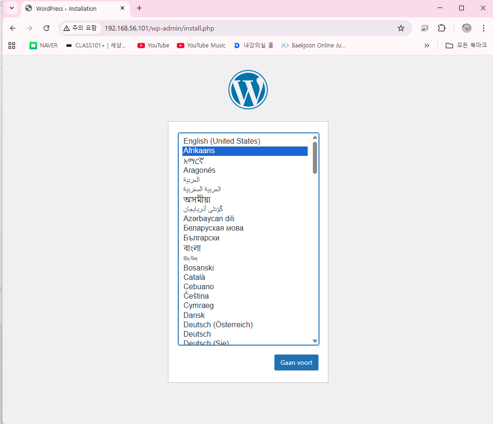

# 5.1 네트워크 유형
- 도커에는 다양한 네트워크 드라이버가 있으며 기본 네트워크 드라이버는 `bridge`, `host`, `null(none)`이 있음
- `docker network ls`로 목록을 확인한 수 있음
```sh
vagrant@docker:~$ docker network ls
NETWORK ID     NAME      DRIVER    SCOPE
b72b1f1210ec   bridge    bridge    local
5bb4314ac5ca   host      host      local
f4dcc023f043   none      null      local
```

## 5.1.1 Bridge
- 컨테이너가 통신하는 사설 네트워크로, 같은 bridge에 연결되어 있으면 컨테이너의 ip 주소로 통신 가능
- 외부로 통신할 때는 `NAPT` 통신을 사용하며, 외부에서 bridge 로 통신하려면 `포트 포워딩`을 사용해야 함
```sh
vagrant@docker:~$ docker network inspect bridge 
vagrant@docker:~$ docker network inspect host

vagrant@docker:~$ docker container run --network bridge -d --name br-web httpd:latest 
2f5328b92467bfdc70d303b0fe0d8b98e2156fbbf2bbc200e26b4a693f32b15f

vagrant@docker:~$ docker container inspect br-web | grep IPAddr
                    "IPAddress": "172.17.0.2",

vagrant@docker:~$ ip addr show docker0 | grep -w inet
    inet 172.17.0.1/16 brd 172.17.255.255 scope global docker0

vagrant@docker:~$ ip route
default via 10.0.2.2 dev enp0s3 proto dhcp src 10.0.2.15 metric 100 
8.8.8.8 via 10.0.2.2 dev enp0s3 proto dhcp src 10.0.2.15 metric 100
10.0.2.0/24 dev enp0s3 proto kernel scope link src 10.0.2.15 metric 100
10.0.2.2 dev enp0s3 proto dhcp scope link src 10.0.2.15 metric 100
168.126.63.1 via 10.0.2.2 dev enp0s3 proto dhcp src 10.0.2.15 metric 100
172.17.0.0/16 dev docker0 proto kernel scope link src 172.17.0.1
192.168.56.0/24 dev enp0s8 proto kernel scope link src 192.168.56.101

vagrant@docker:~$ curl 172.17.0.2
<!DOCTYPE HTML PUBLIC "-//W3C//DTD HTML 4.01//EN" "http://www.w3.org/TR/html4/strict.dtd">
<html>
<head>
<title>It works! Apache httpd</title>
</head>
<body>
<p>It works!</p>
</body>
</html>
```
## 5.1.2 host
- 호스트에서 컨테이너의 네트워크 격리를 해제하여 호스트의 네트워크 정보를 공유해서 사용하는 방법
- 컨테이너는 호스트 입장에서는 하나의 프로세스이기 때문에 가상머신과 다르게 네트워크 정보를 공유할 수 있음
- 컨테이너가 이 네트워크를 사용할 때 컨테이너의 포트가 호스트에서 사용하는 포트와 충돌하면 안 됨
```sh
vagrant@docker:~$ docker container run --network host -d --name host-web httpd:latest 
b7963a38cd06b475e0872f1a9ac52776e9db7b8bba93be5cc0199d41067990c9

vagrant@docker:~$ docker container ls
CONTAINER ID   IMAGE          COMMAND              CREATED          STATUS          PORTS     NAMES
b7963a38cd06   httpd:latest   "httpd-foreground"   13 seconds ago   Up 12 seconds             host-web
3d3d0eda1083   httpd:latest   "httpd-foreground"   33 seconds ago   Up 32 seconds   80/tcp    br-web

vagrant@docker:~$ docker container inspect host-web
vagrant@docker:~$ curl localhost
<!DOCTYPE HTML PUBLIC "-//W3C//DTD HTML 4.01//EN" "http://www.w3.org/TR/html4/strict.dtd">
<html>
<head>
<title>It works! Apache httpd</title>
</head>
<body>
<p>It works!</p>
</body>
</html>

vagrant@docker:~$ ip addr show
...
2: enp0s3: <BROADCAST,MULTICAST,UP,LOWER_UP> mtu 1500 qdisc fq_codel state UP group default qlen 1000
    link/ether 08:00:27:c6:77:14 brd ff:ff:ff:ff:ff:ff
    inet 10.0.2.15/24 metric 100 brd 10.0.2.255 scope global dynamic enp0s3
       valid_lft 56041sec preferred_lft 56041sec
    inet6 fd17:625c:f037:2:a00:27ff:fec6:7714/64 scope global dynamic mngtmpaddr noprefixroute
       valid_lft 86384sec preferred_lft 14384sec
    inet6 fe80::a00:27ff:fec6:7714/64 scope link
       valid_lft forever preferred_lft forever
3: enp0s8: <BROADCAST,MULTICAST,UP,LOWER_UP> mtu 1500 qdisc fq_codel state UP group default qlen 1000
    link/ether 08:00:27:81:64:dc brd ff:ff:ff:ff:ff:ff
    inet 192.168.56.101/24 brd 192.168.56.255 scope global enp0s8
       valid_lft forever preferred_lft forever
    inet6 fe80::a00:27ff:fe81:64dc/64 scope link
       valid_lft forever preferred_lft forever
...

vagrant@docker:~$ curl 192.168.56.101
<!DOCTYPE HTML PUBLIC "-//W3C//DTD HTML 4.01//EN" "http://www.w3.org/TR/html4/strict.dtd">
<html>
<head>
<title>It works! Apache httpd</title>
</head>
<body>
<p>It works!</p>
</body>
</html>

vagrant@docker:~$ curl 10.0.2.15
<!DOCTYPE HTML PUBLIC "-//W3C//DTD HTML 4.01//EN" "http://www.w3.org/TR/html4/strict.dtd">
<html>
<head>
<title>It works! Apache httpd</title>
</head>
<body>
<p>It works!</p>
</body>
```

```sh

vagrant@docker:~$ sudo ss -nltp
State      Recv-Q      Send-Q           Local Address:Port           Peer Address:Port     Process
LISTEN     0           4096                127.0.0.54:53                  0.0.0.0:*         users:(("systemd-resolve",pid=533,fd=17))
LISTEN     0           4096             127.0.0.53%lo:53                  0.0.0.0:*         users:(("systemd-resolve",pid=533,fd=15))
LISTEN     0           511                          *:80                        *:*         users:(("httpd",pid=13166,fd=4),("httpd",pid=13165,fd=4),("httpd",pid=13164,fd=4),("httpd",pid=13150,fd=4))     
LISTEN     0           4096                         *:22                        *:*         users:(("sshd",pid=1028,fd=3),("systemd",pid=1,fd=201))

vagrant@docker:~$ docker container rm -f host-web 
vagrant@docker:~$ sudo apt install -y apache2

vagrant@docker:~$ docker container run --network host -d --name host-web httpd:latest 
vagrant@docker:~$ docker container ls -a

vagrant@docker:~$ docker container logs host-web 
vagrant@docker:~$ docker container run -d --name web02 httpd:latest 
vagrant@docker:~$ docker container run -d --name web03 httpd:latest 

vagrant@docker:~$ docker container ls
```

## 5.1.3 null(none)
- 컨테이너의 네트워크 기능을 사용하지 않음

# 5.2 컨테이너의 통신
# 5.2.1 포트 포워딩 (docker run -p)
- 브릿지 네트워크를 사용하는 모든 컨테이너는 외부에서 접근할 때 `포트 포워딩`을 해야 함
- 포트 포워딩을 하려면 컨테이너를 실행할 때 `-p` 옵션을 사용함
```sh
vagrant@docker:~$ docker container run --network host -d --name web01 httpd:latest 
6d434b9856dd4305f7dc063896a5aabd10969425349abb892a3c251f6feee478

vagrant@docker:~$ sudo ss -nltp | grep 80
LISTEN 0      511                *:80              *:*    users:(("httpd",pid=11351,fd=4),("httpd",pid=11350,fd=4),("httpd",pid=11349,fd=4),("httpd",pid=11330,fd=4))

vagrant@docker:~$ sudo systemctl stop apache2

vagrant@docker:~$ docker container run --network host -d --name web02 httpd:latest 
30a89ed2dc6003fce6330e18039319bfcecb664bf5d9f138cdfc6e0f11c7a951

vagrant@docker:~$ docker container ls
CONTAINER ID   IMAGE          COMMAND              CREATED          STATUS          PORTS     NAMES
6d434b9856dd   httpd:latest   "httpd-foreground"   26 seconds ago   Up 26 seconds             web01

vagrant@docker:~$ docker container run -d --network host --name db01 -e MYSQL_ROOT_PASSWORD=123 -v db-vol:/var/lib/mysql mysql:latest 
bec253dcd165d6e71959d0e94db76e35d0d4a3675612a56a2d0fcbe57bcef2f9

vagrant@docker:~$ docker container ls
CONTAINER ID   IMAGE          COMMAND                  CREATED          STATUS          PORTS     NAMES
bec253dcd165   mysql:latest   "docker-entrypoint.s…"   9 seconds ago    Up 8 seconds              db01
6d434b9856dd   httpd:latest   "httpd-foreground"       39 seconds ago   Up 39 seconds             web01

vagrant@docker:~$ sudo ss -nltp
State      Recv-Q     Send-Q           Local Address:Port            Peer Address:Port     Process
LISTEN     0          4096                127.0.0.54:53                   0.0.0.0:*         users:(("systemd-resolve",pid=533,fd=17))
LISTEN     0          4096             127.0.0.53%lo:53                   0.0.0.0:*         users:(("systemd-resolve",pid=533,fd=15))
LISTEN     0          4096                         *:3306                       *:*         users:(("mysqld",pid=11568,fd=20))
LISTEN     0          70                           *:33060                      *:*         users:(("mysqld",pid=11568,fd=18))
LISTEN     0          511                          *:80                         *:*         users:(("httpd",pid=11351,fd=4),("httpd",pid=11350,fd=4),("httpd",pid=11349,fd=4),("httpd",pid=11330,fd=4))     
LISTEN     0          4096                         *:22                         *:*         users:(("sshd",pid=1028,fd=3),("systemd",pid=1,fd=201))
```
```sh
vagrant@docker:~$ docker container run --network bridge --name test1 -itd alpine:latest 
f3c283cbf00a0baf7a3798e7acce97e1a96f3a631c02a70993e944ea49c76291
vagrant@docker:~$ docker container run --network bridge --name test2 -itd alpine:latest 
48c48b70a48659912d6491decad091ad57b0d2d96142392821833470a17e1530
vagrant@docker:~$ docker container run --network new-bridge --name test3 -itd alpine:latest 
e894ef48313bbbee880e62c32d61d08befa8e7e603e4821cea635b38c08c4589

vagrant@docker:~$ docker container inspect test1 | grep IPAddr
                    "IPAddress": "172.17.0.2",
vagrant@docker:~$ docker container inspect test2 | grep IPAddr
                    "IPAddress": "172.17.0.3",
vagrant@docker:~$ docker container inspect test3 | grep IPAddr
                    "IPAddress": "172.18.0.2",

vagrant@docker:~$ docker network connect bridge test3
vagrant@docker:~$ docker container inspect test3 | grep IPAddr
                    "IPAddress": "172.17.0.4",
                    "IPAddress": "172.18.0.2",
                    

vagrant@docker:~docker container run --network new-bridge --name test4 -itd alpine:latest
71e2fb2d476dd6a4d6b9ac698fe936cf32cc4acf9c750edfd1b3aa131bd89362

vagrant@docker:~$ docker container inspect test4 | grep IPAddr
                    "IPAddress": "172.18.0.3",
vagrant@docker:~$ docker container attach test3
/ # ping test4
PING test4 (172.18.0.3): 56 data bytes
64 bytes from 172.18.0.3: seq=0 ttl=64 time=0.051 ms
64 bytes from 172.18.0.3: seq=1 ttl=64 time=0.183 ms
^C
--- test4 ping statistics ---
2 packets transmitted, 2 packets received, 0% packet loss
round-trip min/avg/max = 0.051/0.117/0.183 ms
```
```sh
vagrant@docker:~$ docker container stop web02
web02
vagrant@docker:~$ docker container run -d --name br-web01 httpd:latest 
50d9184e2521147022433b796aa43e3dd816f617c49980591c0a3ba1199f780d
vagrant@docker:~$ docker container run -p 80:80 -d --name br-web02 httpd:latest 
b6581110228a420749e62b4612840c9024713906525cbcf9dc288612aa8e2c39

vagrant@docker:~$ sudo ss -nlpt | grep 80
LISTEN 0      511                *:80               *:*    users:(("httpd",pid=11351,fd=4),("httpd",pid=11350,fd=4),("httpd",pid=11349,fd=4),("httpd",pid=11330,fd=4))
vagrant@docker:~$ docker container run -p 8080:80 -d --name br-web03 httpd:latest 
3ebc4011bdbacf78fc7dcf24740c3c6919e51ae3b1fbabc9c5b1ddda87b5a736
vagrant@docker:~$ sudo ss -nlpt | grep 80
LISTEN 0      4096         0.0.0.0:8080       0.0.0.0:*    users:(("docker-proxy",pid=12541,fd=7))
LISTEN 0      4096            [::]:8080          [::]:*    users:(("docker-proxy",pid=12547,fd=7))
LISTEN 0      511                *:80               *:*    users:(("httpd",pid=11351,fd=4),("httpd",pid=11350,fd=4),("httpd",pid=11349,fd=4),("httpd",pid=11330,fd=4))
```

---
### 도커 네트워크 실습 가이드
0. 준비단계
실행 중인 컨테이너를 모두 중지하고, 모든 컨테이너를 삭제하세요. 그리고
docker network rm 명령어로 실습 때 만들었던 네트워크를 삭제하세요.
```sh
vagrant@docker:~$ docker container rm -f $(docker container ls -aq)

vagrant@docker:~$ docker network ls
NETWORK ID     NAME         DRIVER    SCOPE
b72b1f1210ec   bridge       bridge    local
5bb4314ac5ca   host         host      local
d275a8616a98   new-bridge   bridge    local
f4dcc023f043   none         null      local

vagrant@docker:~$ docker network rm -f d275a8616a98
d275a8616a98
```

1. 현재 존재하는(기본3가지) 네트워크 목록을 확인하고 각각의 세부 정보를 보세요.
```sh
vagrant@docker:~$ docker network ls
vagrant@docker:~$ docker network inspect bridge
vagrant@docker:~$ docker network inspect host
vagrant@docker:~$ docker network inspect none
```

2. 다음 조건에 맞는 컨테이너를 생성하세요.
- 네트워크이름 : bridge
- 컨테이너 이름 : os01
- 이미지 : centos:7
```sh
vagrant@docker:~$ docker container run --network bridge --name os01 -itd centos:7
```

3. 다음 조건에 맞는 컨테이너를 생성하세요.
- 네트워크 : bridge
- 이름 : web01
- 이미지 : httpd
```sh
vagrant@docker:~$ docker container run --network bridge --name web01 -itd httpd:latest
```

4. os01과 web01 컨테이너의 IP주소를 확인하세요.
```sh
vagrant@docker:~$ docker inspect os01 | grep IPAddr
                    "IPAddress": "172.17.0.2",
vagrant@docker:~$ docker inspect web01 | grep IPAddr
                    "IPAddress": "172.17.0.3",
```

5. os01 컨테이너에서 web01 컨테이너로 ping 을 보내보고 curl 로 접속해보세요.
```sh
vagrant@docker:~$ docker container exec -it os01 bash

[root@50a45b5ac1aa /]# ping 172.17.0.3
PING 172.17.0.3 (172.17.0.3) 56(84) bytes of data.
64 bytes from 172.17.0.3: icmp_seq=1 ttl=64 time=0.144 ms
64 bytes from 172.17.0.3: icmp_seq=2 ttl=64 time=0.038 ms
^C
--- 172.17.0.3 ping statistics ---
2 packets transmitted, 2 received, 0% packet loss, time 1057ms
rtt min/avg/max/mdev = 0.038/0.091/0.144/0.053 ms

[root@50a45b5ac1aa /]# curl 172.17.0.3
<!DOCTYPE HTML PUBLIC "-//W3C//DTD HTML 4.01//EN" "http://www.w3.org/TR/html4/strict.dtd">
<html>
<head>
<title>It works! Apache httpd</title>
</head>
<body>
<p>It works!</p>
</body>
</html>
```

6. exec 명령어로 web01 컨테이너에서 os01 컨테이너로 ping 을 보내보세요.
```sh
vagrant@docker:~$ docker container exec -it web01 bash

root@aa19858f10d0:/usr/local/apache2# apt update
root@aa19858f10d0:/usr/local/apache2# ping 172.17.0.2
PING 172.17.0.2 (172.17.0.2) 56(84) bytes of data.                                                                                                                                                          
64 bytes from 172.17.0.2: icmp_seq=1 ttl=64 time=0.041 ms
64 bytes from 172.17.0.2: icmp_seq=2 ttl=64 time=0.031 ms
^C
--- 172.17.0.2 ping statistics ---
2 packets transmitted, 2 received, 0% packet loss, time 1041ms
rtt min/avg/max/mdev = 0.031/0.036/0.041/0.005 ms
```

7. 다음 조건에 맞는 컨테이너를 생성하세요.
- 네트워크 : host
- 이름 : web02
- 이미지 : httpd
```sh
vagrant@docker:~$ docker container run --network host --name web02 -itd httpd:latest
9cccd0e46255884411b7f8a9a253653938308c6cb3bc4dcd25b70d29ca024172
```

8. web02 의 IP 주소를 확인해보고 호스트의 IP주소로 접속해보세요. (어떤 주소든 무관)
```sh
vagrant@docker:~$ docker container inspect web02 | grep IPAddr
                    "IPAddress": "",

vagrant@docker:~$ hostname -I
10.0.2.15 192.168.56.101 172.17.0.1 fd17:625c:f037:2:a00:27ff:fec6:7714 

vagrant@docker:~$ curl 192.168.56.101
<!DOCTYPE HTML PUBLIC "-//W3C//DTD HTML 4.01//EN" "http://www.w3.org/TR/html4/strict.dtd">
<html>
<head>
<title>It works! Apache httpd</title>
</head>
<body>
<p>It works!</p>
</body>
</html>
```

9. 다음 조건에 맞는 컨테이너를 생성하세요.
- 네트워크 : bridge
- 이름 : web03
- 이미지 : httpd
- 포트포워딩 : 호스트포트 8080
```sh
vagrant@docker:~$ docker container run --network bridge -p 8080:80 --name web03 -itd httpd:latest
3780770e6998becbd80b04dbb714990a2e698c327a3beb225902fd2543fff497
```

10. web03 컨테이너의 IP주소를 확인해보고 접속해보세요. 
( 로컬호스트로도 접속해보세요, 둘다 포트번호까지 지정해야 합니다.)
```sh
vagrant@docker:~$ docker container inspect web03 | grep IPAddr
                    "IPAddress": "172.17.0.4",

vagrant@docker:~$ curl 172.17.0.4
<!DOCTYPE HTML PUBLIC "-//W3C//DTD HTML 4.01//EN" "http://www.w3.org/TR/html4/strict.dtd">
<html>
<head>
<title>It works! Apache httpd</title>
</head>
<body>
<p>It works!</p>
</body>
</html>

vagrant@docker:~$ curl localhost:8080
<!DOCTYPE HTML PUBLIC "-//W3C//DTD HTML 4.01//EN" "http://www.w3.org/TR/html4/strict.dtd">
<html>
<head>
<title>It works! Apache httpd</title>
</head>
<body>
<p>It works!</p>
</body>
</html>
```

11. 네트워크를 새로 만드세요.
- 종류 : bridge
- 이름 : new-br
```sh
vagrant@docker:~$ docker network create -d bridge new-br
c7688e419c721359846172325a6c86581c5678cb14ac8fa591c90f132c30fa66
```

12. 네트워크 세부정보와 새로 생성된 브릿지를 ip addr show 로 확인해보세요.
```sh
vagrant@docker:~$ ip addr show
...
47: br-c7688e419c72: <NO-CARRIER,BROADCAST,MULTICAST,UP> mtu 1500 qdisc noqueue state DOWN group default
    link/ether a6:99:ed:1d:80:34 brd ff:ff:ff:ff:ff:ff
    inet 172.18.0.1/16 brd 172.18.255.255 scope global br-c7688e419c72
       valid_lft forever preferred_lft forever
```

13. 새로 생성한 브릿지에 컨테이너를 생성하고 테스트해봅시다.
- 이미지 : httpd
- 컨테이너이름 : web04
- 네트워크 : new-br
```sh
vagrant@docker:~$ docker container run --network new-br --name web04 -itd httpd:latest
bf108ba7cc7a6e2ad5645cfcefbf7db43d5df4b21ef6aedec246a76bc892a26f
```

14. 새로 생성한 브릿지에 컨테이너를 생성하고 테스트해봅시다.
- 이미지 : centos:7
- 컨테이너이름 : os02
- 네트워크 : new-br
```sh
vagrant@docker:~$ docker container run --network new-br -itd --name os02 centos:7
```

15. os02 에서 web04 로 IP주소와 컨테이너 이름으로 접속해보세요. (curl 사용)
```sh
vagrant@docker:~$ docker inspect web04 | grep IPAddress
                    "IPAddress": "172.18.0.2",

vagrant@docker:~$ docker exec -it os02 /bin/bash

[root@8b9e0180f9bd /]# curl 172.18.0.2
<!DOCTYPE HTML PUBLIC "-//W3C//DTD HTML 4.01//EN" "http://www.w3.org/TR/html4/strict.dtd">
<html>
<head>
<title>It works! Apache httpd</title>
</head>
<body>
<p>It works!</p>
</body>
</html>

[root@8b9e0180f9bd /]# curl web04 
<!DOCTYPE HTML PUBLIC "-//W3C//DTD HTML 4.01//EN" "http://www.w3.org/TR/html4/strict.dtd">
<html>
<head>
<title>It works! Apache httpd</title>
</head>
<body>
<p>It works!</p>
</body>
</html>
```

16. os01 컨테이너를 new-br 네트워크에 연결하고 IP주소를 확인해보세요.
```sh
vagrant@docker:~$ docker network connect new-br os01
vagrant@docker:~$ docker inspect os01 | grep IPAddr
                    "IPAddress": "172.17.0.2",
                    "IPAddress": "172.18.0.4",
```

17. os01 에서 os02 로 ping 보내보고 web04 에 curl 로 접속해보기.
```sh
vagrant@docker:~$ docker exec -it os01 /bin/bash

[root@50a45b5ac1aa /]# ping os02
PING os02 (172.18.0.3) 56(84) bytes of data.
64 bytes from os02.new-br (172.18.0.3): icmp_seq=1 ttl=64 time=0.086 ms
64 bytes from os02.new-br (172.18.0.3): icmp_seq=2 ttl=64 time=0.059 ms
^C
--- os02 ping statistics ---
2 packets transmitted, 2 received, 0% packet loss, time 1063ms
rtt min/avg/max/mdev = 0.059/0.072/0.086/0.015 ms

[root@50a45b5ac1aa /]# curl web04
<!DOCTYPE HTML PUBLIC "-//W3C//DTD HTML 4.01//EN" "http://www.w3.org/TR/html4/strict.dtd">
<html>
<head>
<title>It works! Apache httpd</title>
</head>
<body>
<p>It works!</p>
</body>
</html>
```

18. os02 를 new-br 네트워크와 연결을 해제하고 inspect로 확인해보기
```sh
vagrant@docker:~$ docker network disconnect new-br os02

vagrant@docker:~$ docker container inspect os02

vagrant@docker:~$ docker container inspect os02 | grep Networks
            "Networks": {}
```

19. os02 에서 os01 으로 / web04 으로 ping / curl 테스트
```sh
vagrant@docker:~$ docker exec -it os02 /bin/bash

[root@8b9e0180f9bd /]# curl 172.17.0.2
curl: (7) Failed to connect to 172.17.0.2: Network is unreachable

[root@8b9e0180f9bd /]# curl 172.18.0.2
curl: (7) Failed to connect to 172.18.0.2: Network is unreachable

[root@8b9e0180f9bd /]# ping 172.18.0.2
connect: Network is unreachable

[root@8b9e0180f9bd /]# ping 172.17.0.2
connect: Network is unreachable
```

20. 모든 컨테이너와 네트워크를 삭제해보세요.
```sh
vagrant@docker:~$ docker container rm -f $(docker container ls -aq)

vagrant@docker:~$ docker network rm c7688e419c72
c7688e419c72
```

## 정리
도커
- 시스템에 컨테이너 가상화 기술을 이용해서 서비스를 운영할 수 있게 해주는 플랫폼
- 웹페이지를 제공하는 웹서버용 프로세스를 격리된 환경(컨테이너)으로 실행
   -> 격리된 네트워크를 통해 다른 서비스(컨테이너)들과 연결 구성 지원
   포트포워딩 등을 통해 외부에서의 접근도 설정 가능
- 리눅스 컨테이너를 제어할 수 있게 해주는 컨테이너 런타임 중에 하나
- 도커를 통해 컨테이너를 실행, 이미지를 생성, 이미지 업/다운로드
    - 이미지: 프로그램 실행 파일 + 라이브러리로 구성된 파일 시스템 구조
    - 컨테이너: 이미지를 메모리에 복사해서 격리 환경에서 동작하는 상태

프로그램, 실행파일, 애플리케이션
  - 개발자가 코드를 구현해서 실행할 수 있게 만든 파일
  -> 이 파일을 실행하면 디스크의 데이터를 메모리에 복사 + cpu를 통해 연산

프로세스
  - 프로세스 동작 시 추가로 불러와 사용해야 하는 코드 등을 라이브러리라고 함

## 명령어
docker image
docker container
docker network
  - create NETWORK: 네트워크 생성 (브릿지로 생성)
  - rm NETWORK: 네트워크 상제 (인스턴스가 없는 네트워크만 삭제 가능)
  - ls: 네트워크 목록 확인
  - inspect NETWORK: 특정 네트워크의 세부 정보 확인 (IP 주소)
  - prune: 모든 네트워크 삭제
  - connect NETWORK CONTAINER: 컨테이너에 네트워크 연결 추가
  - disconnect NETWORK CONTAINER: 컨테이너에 네트워크 연결 해제
docker volume 
  - create VOLUME: 볼륨 생성 (필수 x)
  - rm VOLUME: 볼륨 삭제 (컨테이너에 연결 안 된 볼륨만 삭제 가능)
    볼륨 및 데이터까지 모두 삭제
  - ls: 볼륨 목록 확인
  - inspect VOLUME: 특정 볼륨의 세부 정보 확인 (실제 경로)
  - prune: -a 옵션 없이는 이름 없는 볼륨만 삭제, 옵션 사용시 전체 삭제
  -> 컨테이너 실행 시에만 연결 가능, 해제는 불가
docker container run -v VOLUME:CONTAINER-PATH:PERM

### 볼륨
- 컨테이너의 데이터를 영구 저장
- 컨테이너의 데이터를 공유 (컨테이너-컨테이너, 컨테이너-호스트)
- 볼륨 연결 시 컨테이너 내부의 특정 디렉토리에 연결
  - 데이터가 존재하는 디렉토리에 견결 시 BindMount 방식은 데이터가 사라짐
- 컨테이너 삭제 시에도 데이터는 존재
  -> 새로운 컨테이너를 생성 시 해당 볼륨을 연결하면 데이터를 이어서 사용

### 네트워크
- 컨테이너에 대한 네트워크 연결 구성
  bridge(기본): 내부적으로 격리된 네트워크를 제공 (각 컨테이너마다 IP 할당)
    - 포트 포워딩 설정 시 외부에서도 접근 가능
    - 새로운 브릿지 생성 및 삭제 가능
    - 컨테이너에 여러 개 연결 가능

  host: 실제 네트워크(도커 호스트)를 공유하는 방식
    - 각 컨테이너가 외부에서 접근 가능

  null: 네트워크 기능을 사용하지 않음


# 워드프레스, MySQL 연동
```sh
sudo yum install -y wordpress # 워드 프레스 설치
sudo vim /etc/httpd/conf/wordpress.conf # DB이름, 서버 주소, 사용자/패스워드 등 설정
sudo systemctl enable --now httpd # 웹서비스 동작
sudo firewall-cmd --add-service=http # 방화벽 설정

sudo yum install -y mysql
sudo vim /etc/my.cnf.d/mysql.cnf
sudo systemctl enbale --now mysql
sudo firewall-cmd --add-service=mysql
```
```sh
vagrant@docker:~$ docker image pull wordpress

vagrant@docker:~$ docker network create wp-net
f2b9ca8eb1b492801330fcfb30d9bb8ba7cb847e586dbe0390ef051a8f689f87

vagrant@docker:~$ docker image inspect mysql:latest | grep -A2 Volume
            "Volumes": {
                "/var/lib/mysql": {}
            },
vagrant@docker:~$ docker image inspect wordpress:latest | grep -A2 Volume
            "Volumes": {
                "/var/www/html": {}
            },

vagrant@docker:~$ docker volume create mysql-vol
mysql-vol
vagrant@docker:~$ docker volume create wp-vol
wp-vol

vagrant@docker:~$ docker container run -d --name mydb --network wp-net -v  mysql-vol:/var/lib/mysql -e MYSQL_ROOT_PASSWORD=123 -e MYSQL_DATABASE=wp-db -e MYSQL_USER=wp-user -e MYSQL_PASSWORD=123 mysql:latest
5d27a8f72e06956d952f438803a0f9f9beb5490513bb84e39caaa933089858d0

vagrant@docker:~$ docker container run -d --name mywp --network wp-net -v wp-vol:/var/www/html -e WORDPRESS_DB_HOST=mydb -e WORDPRESS_DB_NAME=wp-db -e WORDPRESS_DB_USER=wp-user -e WORDPRESS_DB_PASSWORD=123 -p 80:80 wordpress:latest
f8df9fe334d0ef0cec01a606d6b15d0568d5d776f062be3448f0d4c8ec14f595

vagrant@docker:~$ ip addr show enp0s8
3: enp0s8: <BROADCAST,MULTICAST,UP,LOWER_UP> mtu 1500 qdisc fq_codel state UP group default qlen 1000
    link/ether 08:00:27:81:64:dc brd ff:ff:ff:ff:ff:ff
    inet 192.168.56.101/24 brd 192.168.56.255 scope global enp0s8
       valid_lft forever preferred_lft forever
    inet6 fe80::a00:27ff:fe81:64dc/64 scope link
       valid_lft forever preferred_lft forever
```
