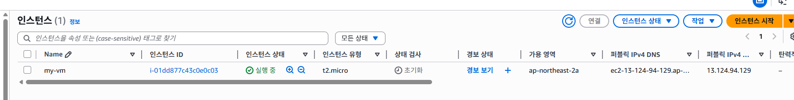

[코드 참고](https://registry.terraform.io/providers/hashicorp/aws/latest)

# 3.1 구성 파일 기본
- 구성 파일에는 프로바이더(Provider), 프로바이더 요구 사항, 리소스 등을 정의함

1. 구성 파일의 블록 정의
2. (옵션) 프로바이더 요구 사항
3. 프로바이더
4. 리소스

```sh
[vagrant@ansible-controller ~]$ mkdir terraform
[vagrant@ansible-controller ~]$ cd terraform/
[vagrant@ansible-controller terraform]$ vi provider.tf

terraform {
  required_providers {
    aws = {
      source = "hashicorp/aws"
      version = "6.25.0"
    }
  }
}
provider "aws" {
  # Configuration options
  profile = "default"
  region = "ap-northeast-2"
}

[vagrant@ansible-controller terraform]$ terraform init
...
Terraform has been successfully initialized!

[vagrant@ansible-controller terraform]$ ls -a
.  ..  provider.tf  .terraform  .terraform.lock.hcl
[vagrant@ansible-controller terraform]$ ls .terraform/providers/registry.terraform.io/hashicorp/aws/6.25.0/linux_amd64/
LICENSE.txt  terraform-provider-aws_v6.25.0_x5

[vagrant@ansible-controller terraform]$ vi vm.tf
resource "aws_instance" "my-instance" {
  ami = "ami-04fcc2023d6e37430"
  instance_type = "t2.micro"

  tags = {
    Name = "my-vm"
  }
}

[vagrant@ansible-controller terraform]$ terraform plan
error
[vagrant@ansible-controller terraform]$ aws sts get-caller-identity
Unable to locate credentials. You can configure credentials by running "aws login".

[vagrant@ansible-controller terraform]$ aws configure
AWS Access Key ID [None]: *
AWS Secret Access Key [None]: *
Default region name [None]: ap-northeast-2
Default output format [None]: json

[vagrant@ansible-controller terraform]$ terraform plan
...
Plan: 1 to add, 0 to change, 0 to destroy.

[vagrant@ansible-controller terraform]$ terraform apply
...
Do you want to perform these actions?
  Terraform will perform the actions described above.
  Only 'yes' will be accepted to approve.

  Enter a value: yes
...
Apply complete! Resources: 1 added, 0 changed, 0 destroyed

```


### 수정
```sh
[vagrant@ansible-controller terraform]$ vi vm.tf
resource "aws_instance" "my-instance" {
  ami           = "ami-04fcc2023d6e37430"
  instance_type = "t2.micro"

  tags = {
    Name = "my-vm-1"
  }
}
resource "aws_instance" "my-instance2" {
  ami           = "ami-04fcc2023d6e37430"
  instance_type = "t2.micro"

  tags = {
    Name = "my-vm-2"
  }
}
```


### 요약
```md
1. AWS 명령어 설치
2. terraform 명령어 설치
(작업시 필요한 인증 정보 설정 
  -> aws에서 액세스 키 생성 및 등록)
(작업 디렉토리 생성 및 이동)
(git으로 버전 관리 하려면 git init 명령어로 초기화 설정)
3. aws configure 설정
  -> 인증 정보 설정 (하나의 파일에 모두 작성하거나 여러 파일로 작성 가능)
4. terraform init
  -> 프로바이더/모듈에 대한 실행파일 설치 (선택)
(terraform validate
  -> 문법만 확인 (선택))
5. terraform plan
  -> 결과 사전 확인
6. terraform apply
  -> 배포
7. ls 명령어로 확인
8. terraform show
9. terraform destroy
10. 액세스 키 제거 (콘솔에서)
```