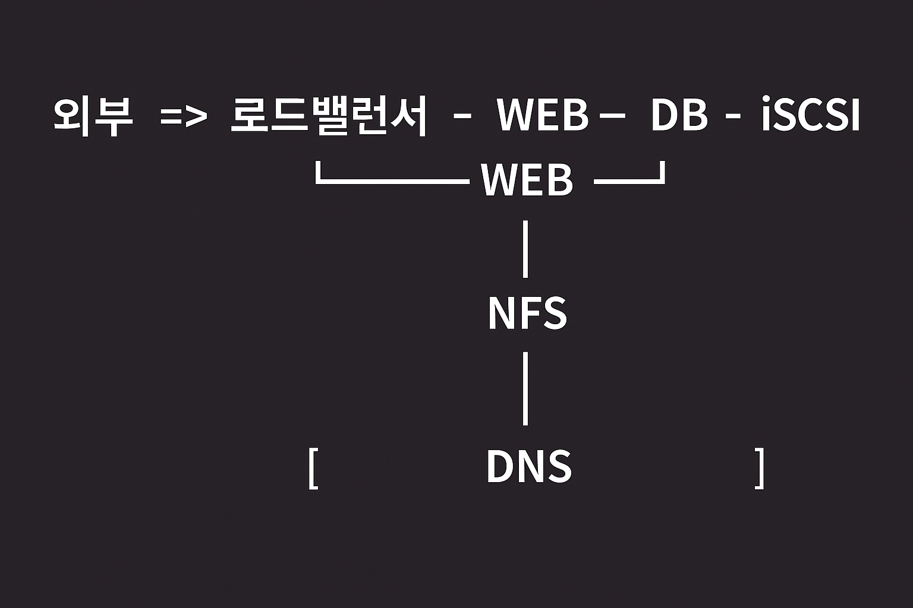

# 기본 구성


## 진행 순서
1. 패키지 설치
2. 서비스 활성화
3. 설정 - 구성 파일, 사용자, 디스크...
4. 서비스 재시작
5. 방화벽 설정

## 25.11.10
#### ip 확인
```
ifconfig
ip addr show enp0s3
```

#### Virtual Box
- nat -> 인터넷만 가능, 네트워크 설정 안 됨 (vagrant ssh로 접속)
- hostonly -> 내부용 (가상머신끼리 통신), IP 주소만 설정
- nat network -> 가상머신끼리 + 인터넷, IP주소/GW/DNS 다 설정
- bridge -> 호스트(실제 컴퓨터)의 네트워크 공유

#### 파티셔닝 시 주의사항
- 시작 섹터는 기본 값
- (MBR의 경우) Primary는 3개만 -> 기본 값
- (MBR의 경우) Extended는 남은 전체 크기로 설정 -> 마지막 섹터도 기본 값


### DB 세팅
```
sudo yum install -y mariadb-server # MariaDB 서버 설치
sudo systemctl enable --now mariadb 
sudo mysql_secure_installation # MariaDB 보안 설정 마법사 실행
sudo vim /etc/my.cnf.d/mariadb-server.cnf # MariaDB 설정 파일 열기

autocommit=0 # 자동 커밋 비활성화 설정

sudo systemctl restart mariadb
sudo firewall-cmd --add-service=mysql
sudo firewall-cmd --add-service=mysql --permanent
```


#### DB 이중화
```
sudo vim /etc/my.cnf.d/mariadb-server.cnf # MariaDB 설정 파일 열기

# 바이너리 로그(binlog)를 활성화/ 이 로그에는 "데이터가 어떻게 변경되었는지" 기록됨/ Slave 서버는 이 로그를 읽어 Master의 변경 사항을 복제
log-bin=mysql-bin 
server-id=101 # 서버 고유 식별 번호/ 복제 환경에서 각 서버는 서로 다른 번호를 가져야 함

sudo systemctl restart mariadb.service
sudo mysql -u root -h localhost -p

# 복제용 계정 (rep_user) 생성 / Slave 서버가 Master DB에 접근하기 위한 전용 사용자 계정 생성
create user rep_user@'%' identified by 'qwer'; 
# 복제 권한 부여
grant replication slave on *.* TO rep_user@'%';
```
```
server-id=102
read_only=1
```

```
[vagrant@WP-DB01 ~]$ sudo mysql -u root -h localhost -p
Enter password: 
Welcome to the MariaDB monitor.  Commands end with ; or \g.
Your MariaDB connection id is 6
Server version: 10.5.29-MariaDB-log MariaDB Server

Copyright (c) 2000, 2018, Oracle, MariaDB Corporation Ab and others.

Type 'help;' or '\h' for help. Type '\c' to clear the current input statement.

MariaDB [(none)]> exit
Bye

[vagrant@WP-DB01 ~]$ sudo mysqldump -u root -p --all-databases > init.db
Enter password: 
[vagrant@WP-DB01 ~]$ scp init.db vagrant@192.168.56.116:/home/vagrant
The authenticity of host '192.168.56.116 (192.168.56.116)' can't be established.
ED25519 key fingerprint is SHA256:RYRBB+HG7p6HlZ+f9REVRIVLMbDqBOGmLLBiYX/G7CY.
This key is not known by any other names
Are you sure you want to continue connecting (yes/no/[fingerprint])? yes
Warning: Permanently added '192.168.56.116' (ED25519) to the list of known hosts.
vagrant@192.168.56.116's password:  vagrant
init.db                                                 100% 2035KB 111.8MB/s   00:00    

[vagrant@WP-DB01 ~]$ ip a
...
3: enp0s8: <BROADCAST,MULTICAST,UP,LOWER_UP> mtu 1500 qdisc fq_codel state UP group default qlen 1000
    link/ether 08:00:27:7f:26:6a brd ff:ff:ff:ff:ff:ff
    inet 192.168.56.115/24 brd 192.168.56.255 scope global noprefixroute enp0s8
       valid_lft forever preferred_lft forever
    inet6 fe80::a00:27ff:fe7f:266a/64 scope link
       valid_lft forever preferred_lft forever
...

[vagrant@WP-DB01 ~]$ sudo mysql -u root -h localhost -p
Enter password: 
Welcome to the MariaDB monitor.  Commands end with ; or \g.
Your MariaDB connection id is 9
Server version: 10.5.29-MariaDB-log MariaDB Server

Copyright (c) 2000, 2018, Oracle, MariaDB Corporation Ab and others.

Type 'help;' or '\h' for help. Type '\c' to clear the current input statement.

MariaDB [(none)]> show master status;
+------------------+----------+--------------+------------------+
| File             | Position | Binlog_Do_DB | Binlog_Ignore_DB |
+------------------+----------+--------------+------------------+
| mysql-bin.000001 |      645 |              |                  |
+------------------+----------+--------------+------------------+
1 row in set (0.000 sec)
```


```
[vagrant@WP-DB02 ~]$ sudo systemctl enable --now mariadb
Created symlink /etc/systemd/system/mysql.service → /usr/lib/systemd/system/mariadb.service.
Created symlink /etc/systemd/system/mysqld.service → /usr/lib/systemd/system/mariadb.service.
Created symlink /etc/systemd/system/multi-user.target.wants/mariadb.service → /usr/lib/systemd/system/mariadb.service.
[vagrant@WP-DB02 ~]$ sudo mysql_secure_installation
...

[vagrant@WP-DB02 ~]$ ip a
...
3: enp0s8: <BROADCAST,MULTICAST,UP,LOWER_UP> mtu 1500 qdisc fq_codel state UP group default qlen 1000
    link/ether 08:00:27:4d:92:c9 brd ff:ff:ff:ff:ff:ff
    inet 192.168.56.116/24 brd 192.168.56.255 scope global noprefixroute enp0s8
       valid_lft forever preferred_lft forever
    inet6 fe80::a00:27ff:fe4d:92c9/64 scope link
       valid_lft forever preferred_lft forever
...

[vagrant@WP-DB02 ~]$ ls
init.db
[vagrant@WP-DB02 ~]$ sudo mysql -u root -p < /home/vagrant/init.db  
[vagrant@WP-DB02 ~]$ sudo mysql -u root -p
Enter password: 
Welcome to the MariaDB monitor.  Commands end with ; or \g.
Your MariaDB connection id is 10
Server version: 10.5.29-MariaDB-log MariaDB Server

Copyright (c) 2000, 2018, Oracle, MariaDB Corporation Ab and others.

Type 'help;' or '\h' for help. Type '\c' to clear the current input statement.

MariaDB [(none)]> change master to master_host='192.168.56.115', master_user='rep_user', master_password='qwer', master_log_file='mysql-bin.000001', master_log_pos=645;
Query OK, 0 rows affected (0.010 sec)

MariaDB [(none)]> start slave;
Query OK, 0 rows affected (0.001 sec)
```

### NFS
1. PACKAGE INSTALL
2. SERCICE ENABLE
3. SHARE DIRECTORY CREATE
4. SHARE SETTING
5. FIREWALL SETTING

```
sudo yum install -y nfs-utils # nfs 서버 / 클라이언트 유틸리티 설치
sudo systemctl enable --now nfs-server # nfs 서버 데몬을 즉시 실행하고, 부팅 시 자동 시작 설정
sudo mkdir /nfs-http # 공유할 디렉토리 생성

sudo vim /etc/exports # nfs 공유 설정 파일 편집
/nfs-http      *(rw,sync,sec=sys)

sudo exportfs -r # nfs 설정 재적용
sudo firewall-cmd --add-service=nfs
sudo firewall-cmd --add-service=nfs --permanent
```

### 스토리지 연결 방식
- DAS: 케이블로 직접 연결
- NAS: 네트워크로 연결하는 방식 -> NFS
- SAN: 네트워크로 연결하는 방식 -> iSCSI
```
sudo vim /nfs-http/index.html
Hello
------------- NFS -------------

------------- WEB -------------

sudo yum install -y httpd
sudo yum install -y nfs-utils

# 원격 NFS 서버 192.168.56.113:/nfs-http를 /var/www/html에 읽기/쓰기 모드로 마운트
sudo mount -o rw,sync,sec=sys -t nfs 192.168.56.113:/nfs-http /var/www/html/
ls /mnt

ls -ldZ /var/www/html
sudo umount /var/www/html/
sudo mount -o rw,sync,sec=sys -t nfs 192.168.56.113:/nfs-http /var/www/html/

ls -ldZ /var/www/html

# /var/www 디렉터리의 SELinux 타입을 httpd_sys_content_t로 임시 변경
sudo chcon -t 'httpd_sys_content_t' /var/www/
# SELinux boolean을 켜서 httpd가 NFS를 사용하도록 허용 (영구 설정)
sudo semanage boolean -m --on httpd_use_nfs

sudo firewall-cmd --add-service=http
sudo firewall-cmd --add-service=http --permanent 
sudo firewall-cmd --reload

curl localhost

```

#### iSCSI
```
sudo yum install -y targetcli
sudo targetcli

ls
# /dev/sdb 장치를 "myblk"라는 이름의 block 백스토어로 등록
backstores/block create name=myblk dev=/dev/sdb 
# 새 iSCSI 타겟(아이디: IQN)을 생성
iscsi/ create iqn.2025-11.com.example.iscsi:target 
# 생성한 타겟(tpg1)의 ACL(접근목록)에 initiator IQN을 허용
iscsi/iqn.2025-11.com.example.iscsi:target/tpg1/acls create iqn.2025-11.com.example.iscsi:initiator
# tpg1에 LUN으로 앞서 만든 백스토어(myblk)를 연결
iscsi/iqn.2025-11.com.example.iscsi:target/tpg1/luns create /backstores/block/myblk
exit

sudo systemctl enable target  # target 서비스를 부팅 시 자동 시작하도록 활성화
sudo firewall-cmd --add-service=iscsi-target # 현재(런타임) 방화벽에 iSCSI 타겟 서비스 허용 (임시)
sudo firewall-cmd --add-service=iscsi-target --permanent  # 방화벽 설정을 영구 저장(재부팅해도 유지)
-----------iSCSI (Server)--------------
``` 

```
-----------WEB (Initiator)-------------
sudo yum install -y iscsi-initiator-utils # 이니시에이터 클라이언트 도구(iscsiadm 등)를 설치
sudo systemctl start iscsi # iscsi 서비스(클라이언트 데몬)를 시작
sudo vim /etc/iscsi/initiatorname.iscsi # 이니시에이터의 IQN(식별자)을 설정하기 위해 파일을 편집

# initiator의 IQN을 파일에 저장 (정확히 이 값이 ACL에 등록되어야 접속 허용)
InitiatorName=iqn.2025-11.com.example.iscsi:initiator 

# 지정한 타겟 호스트(192.168.56.114)에서 서비스 검색(discovery)
sudo iscsiadm -m discovery -t st -p 192.168.56.114
# 검색된 노드 중 특정 IQN 타겟에 로그인(연결)
sudo iscsiadm -m node -T iqn.2025-11.com.example.iscsi:target -l
```

```
sudo iscsiadm -m session -P3 # 현재 iSCSI 세션과 상세 정보를 출력(연결 상태 확인)
lsblk # 현재 시스템에 인식된 블록 디바이스 목록 확인 (/dev/sdc 등)
fdisk /dev/sdc # 새로 연결된 디바이스(/dev/sdc)를 파티셔닝하려면 fdisk로 조작
sudo mkfs -t xfs /dev/sdc # /dev/sdc 전체(또는 파티션)를 XFS 파일시스템으로 포맷 (데이터 삭제 주의)
mount # 현재 마운트된 파일시스템 목록 확인
-> _netdev # (참고) fstab에 네트워크 기반 장치를 마운트할 때 _netdev 옵션을 사용하라는 표시
```

## 25.11.11
### 프록시 서버
- 서버/클라이언트 모델에서 중간자
> 포워드 프록시: 클라이언트 앞에 배치 => 클라이언트 보호
> 리버스 프록시: 서버 앞에 배치 => 서버 보호 및 효율성

### 로드 밸런서
- 여러 서버들에 대해 부하분산
> L4: 포트 번호 기준으로 기본 로드 밸런싱만 지원
> L7: URL 등을 통해 분산하고 추가 기능도 지원
``` 
[vagrant@WP-LB ~]$ sudo yum install -y haproxy &>/dev/null
[vagrant@WP-LB ~]$ sudo ls -l /etc/haproxy/haproxy.cfg
-rw-r--r--. 1 root root 3284 May  2  2025 /etc/haproxy/haproxy.cfg
[vagrant@WP-LB ~]$ sudo vim /etc/haproxy/haproxy.cfg

# main frontend which proxys to the backends
#---------------------------------------------------------------------
frontend main
    bind *:80 # LB 서버에서 80번 포트로 들어오는 요청 수신
    default_backend     app # 들어온 요청을 app 백엔드로 전달

backend app
        balance roundrobin
        server  app1 192.168.56.111:80 check
        server  app2 192.168.56.112:80 check

# 아래 모두 지우기

[vagrant@WP-LB ~]$ sudo systemctl enable --now haproxy.service
[vagrant@WP-LB ~]$ sudo firewall-cmd --add-port=80/tcp
[vagrant@WP-LB ~]$ sudo firewall-cmd --add-port=80/tcp --permanent
[vagrant@WP-LB ~]$ sudo firewall-cmd --reload

sudo ss -nlpt # HAProxy 상태 확인
```
```
[vagrant@WP-WEB01 ~]$ sudo yum install -y httpd
[vagrant@WP-WEB01 ~]$ sudo systemctl enable --now httpd
[vagrant@WP-WEB01 ~]$ sudo firewall-cmd --add-service=http

[vagrant@WP-WEB01 ~]$ echo "Webserver-1" | sudo tee /var/www/html/index.html

# WP-WEB02도 똑같이
[vagrant@WP-WEB02 ~]$ echo "Webserver-2" | sudo tee /var/www/html/index.html
```

### DNS

```
[vagrant@WP-WEB01 ~]$ sudo yum install -y bind # bind (DNS 서버 소프트웨어) 설치
[vagrant@WP-WEB01 ~]$ sudo vim /etc/named.conf

options {
  listen-on port 53 { any; }; # IPv4 모든 인터페이스에서 포트 53 (DNS) 대기
  listen-on-v6 port 53 { none; }; # IPv6은 사용하지 않음
  allow-query     { any; }; # 모든 클라이언트가 쿼리 가능
};
zone "sesac.com." IN { # sesac.com 도메인을 관리
  type  master; # 마스터 DNS 서버임을 지정
  file "sesac.zone"; # zone 파일 지정
};

[vagrant@WP-WEB01 ~]$ sudo cp /var/named/named.empty /var/named/sesac.zone
[vagrant@WP-WEB01 ~]$ sudo vim /var/named/sesac.zone

$TTL 3H # 기본 TTL 3시간
@       IN SOA  dns.sesac.com root.sesac.com. (
                                      0       ; serial # 버전 관리 번호
                                      1D      ; refresh # 슬레이브가 업데이트 주기
                                      1H      ; retry
                                      1W      ; expire # 슬레이브가 master 못 찾으면 만료
                                      3H )    ; minimum # 캐시 최소 TTL
        NS      dns.sesac.com. # 네임 서버 레코드
dns     A       127.0.0.1 # DNS 서버 IP
web01   A       192.168.56.111 # web01 호스트 IP
web02   IN      A       192.168.56.112 # web02 호스트 IP


[vagrant@WP-WEB01 ~]$ sudo systemctl enable --now named.service
[vagrant@WP-WEB01 ~]$ sudo firewall-cmd --add-service=dns
[vagrant@WP-WEB01 ~]$ sudo firewall-cmd --add-service=dns --permanent

#named 권한 수정
sudo chown :named  /var/named/sesac.zone
sudo ls -l /var/named/sesac.zone

#dns 서비스를 활용할 가상머신에 dns ip 기입
[vagrant@WP-WEB01 ~]$ sudo nmcli con modify System\ enp0s8 ipv4.dns  192.168.56.117
[vagrant@WP-WEB01 ~]$ sudo nmcli con up System\ enp0s8
Connection successfully activated (D-Bus active path: /org/freedesktop/NetworkManager/ActiveConnection/4)

#우선 순위 문제로 dns 핑 테스트 불가
[vagrant@WP-WEB01 ~]$ ping web01.sesac.com
ping: web01.sesac.com: Name or service not known

#enp0s3의 우선순위가 더 높기 때문에 enp0s8 
[vagrant@WP-WEB01 ~]$ sudo nmcli con show
NAME           UUID                                  TYPE      DEVICE
enp0s3         53663641-fc96-4c9b-a390-fdc1aa6967cd  ethernet  enp0s3
System enp0s8  00cb8299-feb9-55b6-a378-3fdc720e0bc6  ethernet  enp0s8
lo             3fdffc37-1eee-4e36-88bf-5d604c4e4dbb  loopback  lo

#권한 수정
[vagrant@WP-WEB01 ~]$ sudo nmcli connection modify 'System enp0s8' ipv4.dns-priority 1
[vagrant@WP-WEB01 ~]$ sudo nmcli connection up System\ enp0s8 
[vagrant@WP-WEB01 ~]$ cat /etc/resolv.conf

# Generated by NetworkManager
nameserver 192.168.56.117
nameserver 168.126.63.1
nameserver 8.8.8.8

[vagrant@WP-WEB01 ~]$ ping web01.sesac.com
PING web01.sesac.com (192.168.56.115) 56(84) bytes of data.
64 bytes from WP-WEB01 (192.168.56.115): icmp_seq=1 ttl=64 time=0.039 ms
64 bytes from WP-WEB01 (192.168.56.115): icmp_seq=2 ttl=64 time=0.050 ms
```

